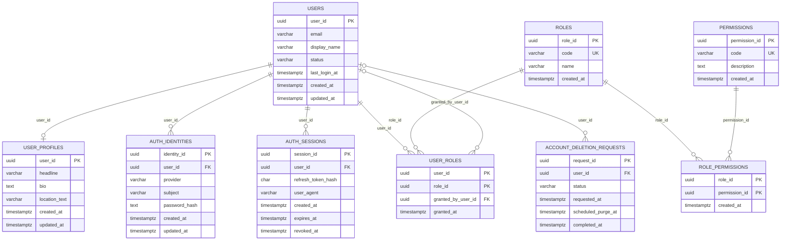
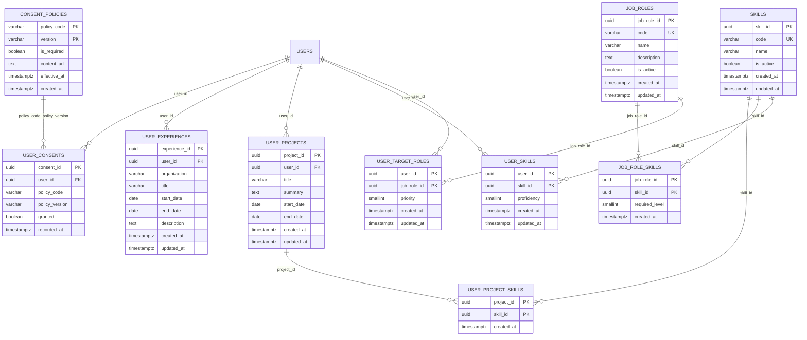
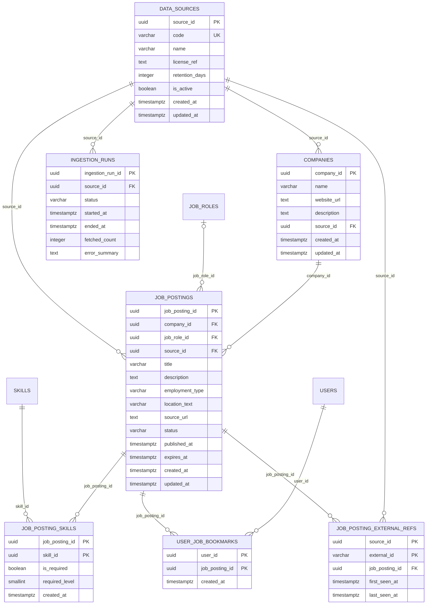
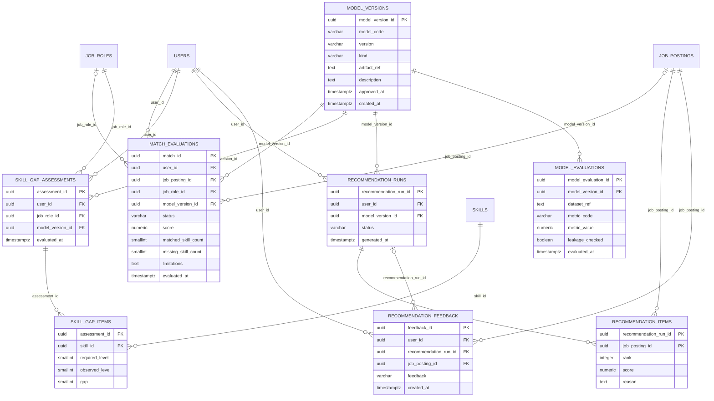
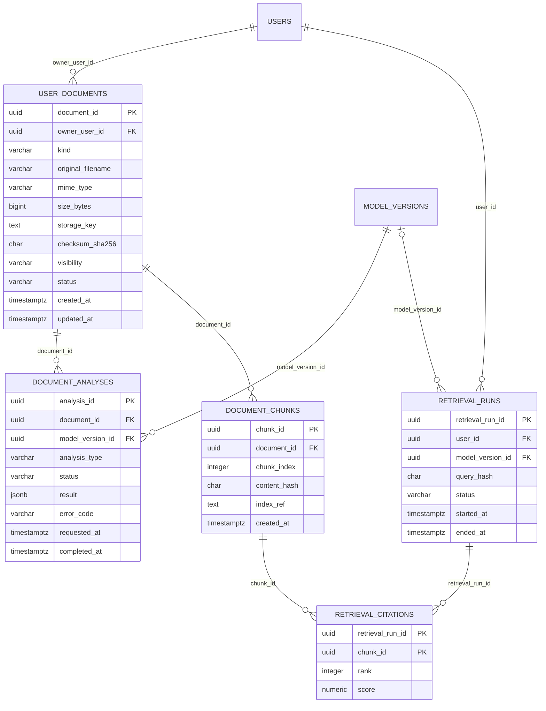
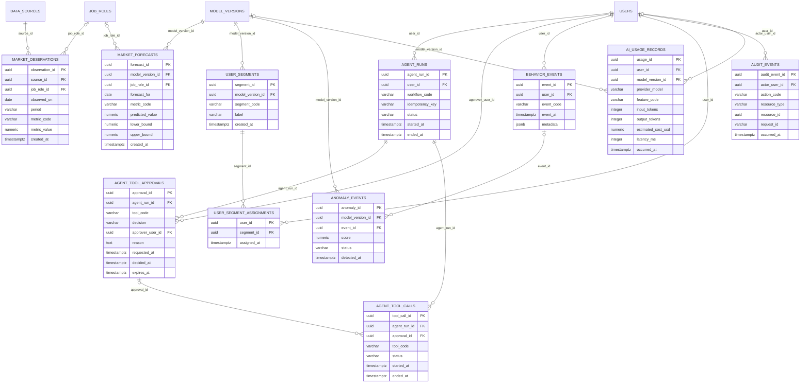

# AI Career Platform — 전체 ERD v0.2

> **자동 생성 파일 — 직접 수정하지 마세요.** 원본: [DATA_DICTIONARY.md](DATA_DICTIONARY.md) · 재생성: `python3 database/model/check_data_dictionary.py --write-erd`
> 테이블 50개, FK 75개. 영역별 그림은 영역 안의 테이블과, 다른 영역 테이블로 향하는 FK를 함께 보여줍니다.

## A. 계정·인증·권한

## B. 동의·경력·역량·직무

## C. 기업·공고·데이터 출처

## D. 매칭·Skill Gap·추천·모델

## E. 문서·RAG

## F. Agent·시장·행동 분석·운영

