# S03 — AI Career Platform 전체 데이터 모델 v0.1

> **상태: FULL-SCOPE DESIGN DRAFT / NOT BASELINED / NOT DEPLOYED**  
> 기준일: 2026-11-06 · 연계 문서: [전체 기능 매핑](../docs/FULL_SCOPE_TRACEABILITY.md) · [전체 설계 계획](../docs/FULL_SCOPE_DESIGN_PLAN.md)
>
> 설계 방식: 전체 시스템의 도메인과 데이터 계약을 **먼저 통합 설계**하고 구현은 버전별 Migration으로 진행. 이 문서의 테이블은 **확정 요구사항이 아닌 설계 후보**. 화면 72개/기존 예상 테이블 45~65개는 미검증 추정치이며 아래 숫자와 일치시킬 의도가 없음.

## 1. 설계 범위·근거와 현재 상태

- GitHub `main` README의 직무매칭/Skill Gap/ML 추천/RAG/LLM Agent 비전.
- 운영 가이드 PR #2의 사용자·프로필·직무·기술·기업·채용공고 및 AI 7종 설계 원칙.
- [F-001~F-030 기능·UI·API 후보](../docs/FULL_SCOPE_TRACEABILITY.md)와 연결. 원본 Redmine·화면·API 요구사항 아직 직접 검증 불가.
- [초기 10개 테이블 DDL](migrations/DRAFT_0001_initial_schema.sql)은 격리 PostgreSQL 18.1 테스트 PASS이나 **전체 서비스용 최종 Migration이 아님**.
- 2026-11-06 Staging DB 실제 조회: 사용자 정의 테이블 0개, `public` 스키마만, `ai_career_poc` SUPERUSER. 백업 아카이브/독립 PostgreSQL 복원 PASS. 이 DB는 **현재 단계에서 변경하지 않음**.

## 2. 공통 물리 설계 정책 (제안)

- PostgreSQL 18.x, 앱 오브젝트 전용 `career` 스키마 제안. 운영·인증·감사 경계가 요구되면 별도 스키마 추가 여부 결정.
- 엔터티 PK는 `uuid PRIMARY KEY DEFAULT gen_random_uuid()`. 연결 테이블은 자연스러운 복합 PK. UUID는 인증 토큰이나 권한 검사를 대체하지 않음.
- `created_at timestamptz NOT NULL DEFAULT now()`, 변경 가능한 엔터티는 `updated_at timestamptz NOT NULL DEFAULT now()`를 공통 후보로 둠. **updated_at 갱신 주체(앱 또는 DB 트리거) 미확정**.
- `deleted_at`/soft-delete는 무조건 적용하지 않음: 사용자 탈퇴·개인정보 보존 및 외부 공고 만료 정책 확정 후 별도로 설계.
- 개인정보를 로그·모델 입력에 무분별하게 중복 저장하지 않음. 외부 문서의 **바이너리는 기본적으로 객체 스토리지**, DB에는 위치·소유자·해시·권한 메타데이터만.
- 역할/권한: **서비스 RBAC 테이블**과 PostgreSQL 로그인/권한 역할은 서로 다름. `career_app` DB 권한을 USER의 서비스 관리자 권한과 혼동하지 않음.
- AI 예측·추천 결과는 모델 버전, 생성 시각, 입력 데이터 계보, 점수 정의 및 평가 근거를 참조. **매칭 점수=채용 성공 확률이라고 표현하지 않음**.
- RAG 청크·임베딩은 검색 인덱스/벡터 저장 위치를 별도 결정하고 저장·삭제·접근권한을 원본 문서와 동기화. pgvector 사용 여부 미결정.
- `CHECK`, `UNIQUE`, FK, 삭제 `ON DELETE` 정책은 후속 물리 DDL에서 실제 제약으로 확정. **FK 인덱스는 PostgreSQL이 자동 생성하지 않음**.

## 3. 전체 엔터티 목록 — 46개 테이블 후보

표의 `PK·주요 컬럼`은 **핵심 컬럼 계약의 초안**입니다. 모든 부가 컬럼이 확정되었다는 의미는 아니며 `?`는 NULL 허용/필수 결정 대기입니다. `FK →`는 대상 PK 참조입니다.

### A. 계정·인증·권한·동의 (8개)

| ID | 테이블 | PK·주요 컬럼 후보 | FK / 유일성·검증 제안 | 기능 |
|---|---|---|---|---|
| A01 | `users` | `user_id uuid`, `email varchar(254)`, `display_name varchar(100)`, `status varchar(20)` | `UNIQUE(email)` 정규화 정책 미정; 활성 상태 CHECK | F-001~005; 기존 10 |
| A02 | `user_profiles` | `user_id uuid`, `headline varchar(200)?`, `bio text?`, `location_text varchar(120)?` | PK·FK → users (1:1), 개인정보 공개 정책 | F-003; 기존 10 |
| A03 | `auth_identities` | `identity_id uuid`, `user_id uuid`, `provider varchar(40)`, `subject varchar(255)` | FK → users, `UNIQUE(provider,subject)`; 외부 IdP 결정 대기 | F-001 |
| A04 | `auth_sessions` | `session_id uuid`, `user_id uuid`, `refresh_token_hash text?`, `expires_at timestamptz`, `revoked_at timestamptz?` | FK → users; **토큰 원문 저장 금지**, 자체 세션 여부 미정 | F-002 |
| A05 | `roles` | `role_id uuid`, `code varchar(64)`, `name varchar(120)` | `UNIQUE(code)`, 서비스 역할 코드 | F-004 |
| A06 | `permissions` | `permission_id uuid`, `code varchar(100)`, `description text?` | `UNIQUE(code)`, 권한 명세 버전 필요 | F-004 |
| A07 | `role_permissions` | `role_id uuid`, `permission_id uuid` | 복합 PK; FK → roles, permissions | F-004 |
| A08 | `user_roles` | `user_id uuid`, `role_id uuid` | 복합 PK; FK → users, roles; 관리자 부여 권한 감사 | F-004 |

### B. 동의·경력·역량 (8개)

| ID | 테이블 | PK·주요 컬럼 후보 | FK / 유일성·검증 제안 | 기능 |
|---|---|---|---|---|
| B01 | `user_consents` | `consent_id uuid`, `user_id uuid`, `policy_code varchar(80)`, `policy_version varchar(40)`, `granted boolean`, `recorded_at timestamptz` | FK → users; 동의의 **변경 이력 보존** 및 철회 처리 | F-005 |
| B02 | `user_experiences` | `experience_id uuid`, `user_id uuid`, `organization varchar(200)`, `title varchar(200)`, `start_date date?`, `end_date date?` | FK → users; 기간 CHECK | F-010 |
| B03 | `user_projects` | `project_id uuid`, `user_id uuid`, `title varchar(200)`, `summary text?` | FK → users; 출처/포트폴리오 공개 수준 | F-010 |
| B04 | `job_roles` | `job_role_id uuid`, `code varchar(64)`, `name varchar(160)` | `UNIQUE(code)`; 직무 분류체계 출처·버전 | F-006; 기존 10 |
| B05 | `skills` | `skill_id uuid`, `code varchar(64)`, `name varchar(160)` | `UNIQUE(code)`; 기술명 동의어 정책 | F-007; 기존 10 |
| B06 | `job_role_skills` | `job_role_id uuid`, `skill_id uuid`, `importance smallint?` | 복합 PK; FK → job_roles, skills; 중요도 1~5 후보 | F-014; 기존 10 |
| B07 | `user_skills` | `user_id uuid`, `skill_id uuid`, `proficiency smallint?` | 복합 PK; FK → users, skills; 근거/자기평가 구분 미정 | F-008; 기존 10 |
| B08 | `user_target_roles` | `user_id uuid`, `job_role_id uuid`, `priority smallint?` | 복합 PK; FK → users, job_roles; 목표 개수·순위 정책 | F-009 |

### C. 기업·공고·수집 (7개)

| ID | 테이블 | PK·주요 컬럼 후보 | FK / 유일성·검증 제안 | 기능 |
|---|---|---|---|---|
| C01 | `companies` | `company_id uuid`, `name varchar(200)`, `website_url text?` | 기업명 단독 UNIQUE 금지(동명이업), 외부 ID 정책 미정 | F-011; 기존 10 |
| C02 | `job_postings` | `job_posting_id uuid`, `company_id uuid`, `job_role_id uuid?`, `title varchar(240)`, `description text?`, `source_url text?`, `status varchar(20)`, `published_at timestamptz?`, `expires_at timestamptz?` | FK → companies, job_roles; CHECK 상태·날짜 | F-012; 기존 10 |
| C03 | `job_posting_skills` | `job_posting_id uuid`, `skill_id uuid`, `is_required boolean` | 복합 PK; FK → job_postings, skills | F-012/014; 기존 10 |
| C04 | `user_job_bookmarks` | `user_id uuid`, `job_posting_id uuid` | 복합 PK; FK → users, job_postings; MVP 포함 미확정 | F-013; 기존 10 |
| C05 | `data_sources` | `source_id uuid`, `code varchar(80)`, `license_ref text?`, `retention_policy text?` | `UNIQUE(code)`; 데이터 라이선스 계약/사용범위 | F-012/024 |
| C06 | `job_posting_external_refs` | `source_id uuid`, `external_id varchar(240)`, `job_posting_id uuid` | `PK(source_id,external_id)`; FK → data_sources, job_postings; 공고 중복 식별 | F-012 |
| C07 | `ingestion_runs` | `ingestion_run_id uuid`, `source_id uuid`, `status varchar(24)`, `started_at timestamptz`, `ended_at timestamptz?` | FK → data_sources; 수집/품질 증빙, 비밀값 제외 | F-024 |

### D. 매칭·Skill Gap·개인화 (6개)

| ID | 테이블 | PK·주요 컬럼 후보 | FK / 유일성·검증 제안 | 기능 |
|---|---|---|---|---|
| D01 | `model_versions` | `model_version_id uuid`, `model_code varchar(100)`, `version varchar(80)`, `artifact_ref text?`, `approved_at timestamptz?` | `UNIQUE(model_code,version)`, 모델 평가와 연결 | F-015~018/026 |
| D02 | `match_evaluations` | `match_id uuid`, `user_id uuid`, `job_posting_id uuid?`, `job_role_id uuid?`, `model_version_id uuid?`, `score numeric(8,5)?`, `evaluated_at timestamptz` | FK → users, postings, roles, model_versions; 점수 범위 계약 필요 | F-015 |
| D03 | `skill_gap_assessments` | `assessment_id uuid`, `user_id uuid`, `job_role_id uuid`, `model_version_id uuid?`, `evaluated_at timestamptz` | FK → users, job_roles, model_versions; 계산 규칙 버전화 | F-016 |
| D04 | `skill_gap_items` | `assessment_id uuid`, `skill_id uuid`, `required_level smallint?`, `observed_level smallint?` | 복합 PK; FK → skill_gap_assessments, skills | F-016 |
| D05 | `recommendation_runs` | `recommendation_run_id uuid`, `user_id uuid`, `model_version_id uuid?`, `generated_at timestamptz`, `explanation_ref text?` | FK → users, model_versions; 점수·설명 생성 근거 보존 | F-017 |
| D06 | `recommendation_items` | `recommendation_run_id uuid`, `job_posting_id uuid`, `rank integer`, `score numeric(8,5)?`, `feedback varchar(24)?` | 복합 PK; FK → recommendation_runs, job_postings; rank UNIQUE 후보 | F-017/018 |

### E. 문서·RAG (5개)

| ID | 테이블 | PK·주요 컬럼 후보 | FK / 유일성·검증 제안 | 기능 |
|---|---|---|---|---|
| E01 | `user_documents` | `document_id uuid`, `owner_user_id uuid`, `kind varchar(40)`, `storage_key text`, `checksum_sha256 char(64)`, `visibility varchar(24)` | FK → users; 저장 키는 원문 노출/다운로드 URL 아님 | F-019 |
| E02 | `document_analyses` | `analysis_id uuid`, `document_id uuid`, `model_version_id uuid?`, `status varchar(24)`, `result_ref text?` | FK → user_documents, model_versions; 입력·출력 최소 보존 | F-020 |
| E03 | `document_chunks` | `chunk_id uuid`, `document_id uuid`, `chunk_index integer`, `content_hash char(64)`, `index_ref text?` | FK → user_documents; `UNIQUE(document_id,chunk_index)`; 접근권한 상속 | F-021/022 |
| E04 | `retrieval_runs` | `retrieval_run_id uuid`, `user_id uuid`, `query_hash char(64)?`, `started_at timestamptz`, `status varchar(24)` | FK → users; 검색 권한 검증, 질의 원문 저장 정책 미정 | F-021/022 |
| E05 | `retrieval_citations` | `retrieval_run_id uuid`, `chunk_id uuid`, `rank integer`, `score numeric(8,5)?` | 복합 PK; FK → retrieval_runs, document_chunks; 근거 표시 | F-022 |

### F. Agent·ML·운영/감사 (12개)

| ID | 테이블 | PK·주요 컬럼 후보 | FK / 유일성·검증 제안 | 기능 |
|---|---|---|---|---|
| F01 | `agent_runs` | `agent_run_id uuid`, `user_id uuid`, `status varchar(24)`, `started_at timestamptz`, `ended_at timestamptz?` | FK → users; 실행 권한/시간제한 | F-023 |
| F02 | `agent_tool_approvals` | `approval_id uuid`, `agent_run_id uuid`, `approver_user_id uuid?`, `tool_code varchar(100)`, `decision varchar(24)` | FK → agent_runs, users; 승인 시점·유효범위 필요 | F-023 |
| F03 | `agent_tool_calls` | `tool_call_id uuid`, `agent_run_id uuid`, `approval_id uuid?`, `tool_code varchar(100)`, `status varchar(24)`, `started_at timestamptz` | FK → agent_runs, agent_tool_approvals; 사용자 동의·재시도 기록 | F-023 |
| F04 | `model_evaluations` | `model_evaluation_id uuid`, `model_version_id uuid`, `dataset_ref text`, `metric_code varchar(80)`, `metric_value numeric?`, `evaluated_at timestamptz` | FK → model_versions; 누수검사/검증분할 메타데이터 | F-026 |
| F05 | `market_observations` | `observation_id uuid`, `source_id uuid`, `job_role_id uuid?`, `observed_on date`, `metric_code varchar(80)`, `metric_value numeric` | FK → data_sources, job_roles; 단위·집계기간 계약 | F-024 |
| F06 | `market_forecasts` | `forecast_id uuid`, `model_version_id uuid`, `job_role_id uuid?`, `forecast_for date`, `metric_code varchar(80)`, `predicted_value numeric` | FK → model_versions, job_roles; 기간/신뢰도 계약 | F-024 |
| F07 | `behavior_events` | `event_id uuid`, `user_id uuid?`, `event_code varchar(80)`, `event_at timestamptz`, `metadata jsonb?` | FK → users; 동의·최소수집·보존 필수 | F-025 |
| F08 | `user_segments` | `segment_id uuid`, `model_version_id uuid`, `segment_code varchar(80)`, `label varchar(160)` | FK → model_versions; 군집 의미/공정성 평가 | F-025 |
| F09 | `user_segment_assignments` | `user_id uuid`, `segment_id uuid`, `assigned_at timestamptz` | 복합 PK 후보; FK → users, user_segments; 배정 이력 정책 | F-025 |
| F10 | `anomaly_events` | `anomaly_id uuid`, `model_version_id uuid`, `event_id uuid?`, `score numeric?`, `detected_at timestamptz` | FK → model_versions, behavior_events; 보존/오탐 처리 | F-025 |
| F11 | `audit_events` | `audit_event_id uuid`, `actor_user_id uuid?`, `action_code varchar(100)`, `resource_type varchar(80)`, `resource_id uuid?`, `occurred_at timestamptz` | FK → users; 위변조 방지/민감정보 비저장 정책 | F-027/028 |
| F12 | `ai_usage_records` | `usage_id uuid`, `user_id uuid?`, `model_version_id uuid?`, `input_tokens integer?`, `output_tokens integer?`, `estimated_cost numeric(18,6)?`, `occurred_at timestamptz` | FK → users, model_versions; 비용 단위·청구 추정임 명시 | F-028 |

**합계: 8 + 8 + 7 + 6 + 5 + 12 = 46개 후보.** `F-029` 스키마/Seed 버전용 테이블은 Alembic/SQL migration ledger 등의 구현 도구 결정 이후 별도 인프라 객체로 구성하며, 46개 기능 테이블 합계에는 포함하지 않음. 이는 최종 테이블 수 목표가 아님.

## 4. ERD — 전체 영역 간 핵심 관계

```mermaid
erDiagram
 USERS ||--o| USER_PROFILES : has
 USERS ||--o{ AUTH_IDENTITIES : logs_in_with
 USERS ||--o{ USER_ROLES : assigned
 ROLES ||--o{ USER_ROLES : includes
 ROLES ||--o{ ROLE_PERMISSIONS : grants
 PERMISSIONS ||--o{ ROLE_PERMISSIONS : describes
 USERS ||--o{ USER_CONSENTS : records
 USERS ||--o{ USER_EXPERIENCES : has
 USERS ||--o{ USER_PROJECTS : has
 USERS ||--o{ USER_SKILLS : holds
 SKILLS ||--o{ USER_SKILLS : catalog
 USERS ||--o{ USER_TARGET_ROLES : selects
 JOB_ROLES ||--o{ USER_TARGET_ROLES : targets
 JOB_ROLES ||--o{ JOB_ROLE_SKILLS : requires
 SKILLS ||--o{ JOB_ROLE_SKILLS : catalog
 COMPANIES ||--o{ JOB_POSTINGS : publishes
 JOB_ROLES ||--o{ JOB_POSTINGS : classifies
 JOB_POSTINGS ||--o{ JOB_POSTING_SKILLS : requires
 SKILLS ||--o{ JOB_POSTING_SKILLS : catalog
 DATA_SOURCES ||--o{ JOB_POSTING_EXTERNAL_REFS : supplies
 JOB_POSTINGS ||--o{ JOB_POSTING_EXTERNAL_REFS : identified_by
 USERS ||--o{ USER_JOB_BOOKMARKS : saves
 JOB_POSTINGS ||--o{ USER_JOB_BOOKMARKS : saved_in
 USERS ||--o{ MATCH_EVALUATIONS : evaluates
 MODEL_VERSIONS ||--o{ MATCH_EVALUATIONS : scored_by
 USERS ||--o{ SKILL_GAP_ASSESSMENTS : assessed
 SKILL_GAP_ASSESSMENTS ||--o{ SKILL_GAP_ITEMS : contains
 SKILLS ||--o{ SKILL_GAP_ITEMS : measured
 USERS ||--o{ RECOMMENDATION_RUNS : receives
 RECOMMENDATION_RUNS ||--o{ RECOMMENDATION_ITEMS : returns
 JOB_POSTINGS ||--o{ RECOMMENDATION_ITEMS : ranked
 USERS ||--o{ USER_DOCUMENTS : owns
 USER_DOCUMENTS ||--o{ DOCUMENT_CHUNKS : splits
 USER_DOCUMENTS ||--o{ DOCUMENT_ANALYSES : analyzed
 USERS ||--o{ RETRIEVAL_RUNS : queries
 RETRIEVAL_RUNS ||--o{ RETRIEVAL_CITATIONS : cites
 DOCUMENT_CHUNKS ||--o{ RETRIEVAL_CITATIONS : referenced
 USERS ||--o{ AGENT_RUNS : starts
 AGENT_RUNS ||--o{ AGENT_TOOL_CALLS : calls
 AGENT_RUNS ||--o{ AGENT_TOOL_APPROVALS : requests
 MODEL_VERSIONS ||--o{ MODEL_EVALUATIONS : evaluated
 USERS ||--o{ AUDIT_EVENTS : acts
```

이 ERD는 읽기 편하도록 핵심 경로만 표시한 **부분 관계 그림**이며, 상세 FK 목록의 모든 선을 나타내지는 않음.

## 5. 크로스도메인 FK/삭제/소유권 원칙

| 관계 | 설계 검토 포인트 | DDL 전 결정 |
|---|---|---|
| users → 프로필/경력/추천/문서/Agent | 사용자 탈퇴 시 참조·암호화 삭제·집계 익명화 | 보존기간, 동의, 법령, delete policy |
| companies → job_postings → matching | 공고 만료/중복/외부 데이터 철회 시 참조 | logical close vs delete |
| model_versions → prediction/AI outputs | 이미 생성한 결과의 재현성과 모델 아티팩트 보존 | 버전 불변성 및 아티팩트 위치 |
| user_documents → chunks → citations | 파일 삭제/접근권한 변경이 검색 인덱스에 전파 | object storage/벡터DB 구현 결정 |
| agent_runs → calls → approvals | 승인 범위·실행 이력·실패 복구 | 동의/서명/감사 규칙 |
| role_permissions / user_roles | 서비스 권한과 DB 사용자 권한 분리 | 역할 모델·관리자 승인 |

**기본 정책 제안:** FK는 `ON DELETE RESTRICT/NO ACTION` 우선, 자동 CASCADE는 데이터 보존·동의·감사 정책 확정 후 선택. `user_profiles` 등 일부 영역의 삭제 요구와 상충할 수 있으므로 일괄 적용 금지.

## 6. 대표 인덱스·데이터 품질 후보

- `users(email)`: UNIQUE 및 정규화 규칙. `auth_identities(provider,subject)` UNIQUE.
- `user_roles(user_id,role_id)`, `role_permissions(role_id,permission_id)`: 복합 PK.
- `job_postings(company_id)`, `job_postings(job_role_id)`, `job_postings(status,published_at DESC)`: 조회 설계 기반.
- `job_posting_external_refs(source_id,external_id)` UNIQUE(복합 PK).
- `recommendation_items(recommendation_run_id,rank)` UNIQUE 후보, `score` 범위 정의 필요.
- `document_chunks(document_id,chunk_index)` UNIQUE.
- `retrieval_citations(retrieval_run_id,rank)` UNIQUE 후보.
- 사용자별 데이터 접근: `(user_id,created_at)`, `(owner_user_id,created_at)` 등 조회가 확정되면 적용.
- `CHECK` 범위: status 코드, 숙련도 1~5 후보, `expires_at >= published_at`, 토큰/비용/점수 음수 방지 등.
- 민감정보·`jsonb` 동적 필드의 무제한 검색 인덱스/보존은 보안·성능 영향 검토가 선행돼야 함.

## 7. 증분 Migration 계획 (전체 설계 후 분할 적용)

| 버전/단계 후보 | 내용 | 주요 테이블 그룹 | 선행 승인 |
|---|---|---|---|
| M00 | 권한·스키마·version ledger | `career`, DB 역할, migration history | 계정 소유권/Secret 관리 |
| M01 | 사용자·역할·동의 | A01~A08, B01 | 인증 방식, 사용자 유형, 개인정보 |
| M02 | 직무·기술·경력 | B02~B08 | 코드 분류, 숙련도 기준 |
| M03 | 기업·공고·수집 | C01~C07 | 출처/라이선스/중복 정책 |
| M04 | ML·매칭·Skill Gap·추천 | D01~D06, F04 | 점수/모델 버전/검증계약 |
| M05 | 문서·RAG | E01~E05 | 파일/권한/벡터 인덱싱 정책 |
| M06 | Agent·운영·추세 | F01~F03, F05~F12 | 실행승인/감사/수집동의 |
| M07 | FK·Index 최적화/Seed 확정 | 전체 | 실제 API 쿼리·성능/데이터 |

**의존성 참고:** `model_versions`(D01)은 M04에서 만들고, `document_analyses`(E02)는 M05부터 참조 가능; `data_sources`(C05)는 M03에서 만들고 M06 시장 관측에 사용. `auth_sessions`(A04)는 외부 IdP 사용 시 삭제될 수 있음. M04의 `model_versions`은 이후 여러 영역에서 공유하므로 버전 순서를 유지.

**Migration 적용 원칙:** 신규 전체 ERD 승인 → 일회용 DB 통합 CI → DB 백업/복원 확인 → 승인된 Staging 수동 적용 → 검증 증빙 → 다음 버전. 현재 GitHub 자동 앱 배포에 DB Migration 연결 금지.

## 8. Seed 전략 (전체 데이터 기준)

| 데이터 묶음 | 예시 | 방법 | 승인·검증 |
|---|---|---|---|
| 역할·권한 | 서비스 RBAC 기본 코드 | 코드 기반 versioned Seed; upsert | 관리자·권한 모델 승인 |
| 직무·기술 | 표준 직무/기술 목록 | 출처/버전/코드 명시; UPSERT | 외부 데이터 이용권한/코드 중복 |
| 기업·공고 | 가상 기업·공고 | **합성 데이터만**; 외부 실데이터 불허 | FK 건수·중복 검사 |
| 사용자·경력 | 가상 사용자·스킬·프로젝트 | 실제 개인정보/비밀번호 사용 금지 | 사용자의 데이터 격리, 멱등성 |
| AI·RAG·Agent | 가상 문서/모델/런/인용 근거 | 안전한 테스트 Fixture | 모델 근거, 문서 권한/보존 검증 |

테이블 수/Seed 건수 모두 현재 **미확정**. `ON CONFLICT` 등 안정적 자연키 기반 멱등 실행, Seed revision 기록 및 재실행 비교 필수. CI는 Staging 공용 DB가 아닌 독립 DB 사용.

## 9. 전체 설계 승인 및 후속 산출물

- [x] 30개 기능 시나리오 ↔ UI ↔ API ↔ 도메인 매핑 후보
- [x] 전체 영역 46개 테이블 **후보 목록**, 공통 컬럼·관계·인덱스 정책 초안
- [x] 크로스 도메인 핵심 ERD 및 증분 Migration 전략
- [ ] 각 테이블의 **모든 컬럼·자료형·NULL/UNIQUE/FK·소유권·삭제정책** 최종 확정
- [ ] 실제 기능/화면/API 원본 및 사용자 역할·인증·개인정보 정책 승인
- [ ] 통합 API 계약과 전체 DB 테이블 1:1 추적
- [ ] AI/RAG/Agent 저장소·권한/데이터 라이프사이클 확정
- [ ] PM/JM 통합 설계 베이스라인 승인

**판정:** `S03_FULL_DATABASE_MODEL=DRAFT_COMPLETE`, `FULL_SCHEMA_BASELINE=HOLD`, `STAGING_DB_UNCHANGED`. 다음은 S04 전체 API 계약 초안 작성과 S03 ↔ S04 간 정합성 검증.
