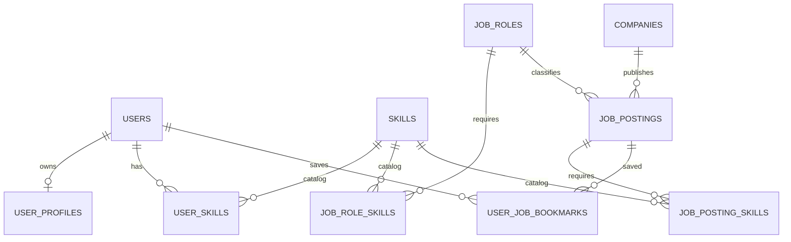

# AI Career Platform — D1 데이터베이스 설계 초안

> 상태: **DRAFT / NOT APPROVED / NOT DEPLOYED** · 기준일: 2026-11-06
>
> 이 문서는 실제 DB를 생성하지 않습니다. 기존 `poc/staging` PostgreSQL 18.1 컨테이너 및 Named Volume은 변경하지 않습니다.

## 1. 근거 및 범위

- 기존 PR #2 `docs/DATABASE.md`: Staging은 공유 통합 테스트용, 공통 Seed는 보존, 스키마 변경은 승인된 Migration으로 관리하며 **자동 배포에 Migration을 연동하지 않음**.
- `docs/ARCHITECTURE.md`: FastAPI Router → Service → Repository → PostgreSQL, 사용자·프로필·직무·기술·기업·채용공고 중심.
- `docs/AI_FEATURES.md`: 직무 매칭/Skill Gap/추천·RAG·Agent는 단계적 확장. 현재 ML 7종은 기획 범위.
- 실제 화면 72개, 요구사항·API 계약·ERD 미확정. 따라서 **테이블 20~25개를 확정 수치로 사용하지 않음**.

## 2. 최소 핵심 테이블 후보 (10개, 전부 승인 전)

| 테이블 | 목적 | PK | 주요 FK / UNIQUE | 비고 |
|---|---|---|---|---|
| `users` | 서비스 사용자 | `user_id` UUID | `email` UNIQUE | 이메일 정규화·탈퇴·인증 정책 검토 |
| `user_profiles` | 사용자 공개 프로필 | `user_id` UUID | FK users(1:1) | 민감 정보 최소화 |
| `companies` | 기업 기본 정보 | `company_id` UUID | 필요시 `external_source, external_id` UNIQUE | 수집 출처·사용권한 별도 정책 |
| `job_roles` | 표준 직무 분류 | `job_role_id` UUID | `code` UNIQUE | 기준 코드·버전 확정 필요 |
| `skills` | 표준 기술 분류 | `skill_id` UUID | `code` UNIQUE | 명칭 변경 대비 고정 코드 |
| `job_role_skills` | 직무 요구 기술 | (`job_role_id`, `skill_id`) | FK job_roles, skills | 요구 수준 정의 미확정 |
| `user_skills` | 사용자 보유 기술 | (`user_id`, `skill_id`) | FK users, skills | 근거·자기평가 구분 검토 |
| `job_postings` | 채용공고 | `job_posting_id` UUID | FK companies, job_roles | 만료일·출처·중복 처리 정책 필요 |
| `job_posting_skills` | 공고 요구 기술 | (`job_posting_id`, `skill_id`) | FK postings, skills | 우대/필수 여부 후보 |
| `user_job_bookmarks` | 사용자 공고 북마크 | (`user_id`, `job_posting_id`) | FK users, postings | MVP 범위 검토 필요 |

### ERD 초안 (논리적 관계만; 물리 DDL 아님)

## 3. 물리 설계 공통 결정 후보

- PostgreSQL 18.x, 별도 애플리케이션 스키마 `career` **후보**. 현재 기존 `public` 구조 조사 후 확정.
- 신규 PK는 UUID 후보; 일부 코드형 기준 데이터는 stable `code` 사용.
- 모든 시간은 DB에 `timestamptz`(UTC 기준) 저장, API 표현은 ISO 8601.
- 일반 테이블 `created_at` / `updated_at`, 필요한 경우 `deleted_at`; 삭제 정책은 개인정보 요구사항 검토 후 결정.
- 관계형 연결 테이블에 복합 PK와 FK 적용. FK 컬럼 인덱스는 실제 조회 패턴 확인 후 지정.
- `email`의 중복 판정(대소문자·공백·정규화), 인증 식별자, 사용자 삭제 처리 등은 **미확정**.
- UNIQUE/FK/CHECK/NOT NULL과 최소 권한을 우선. 인덱스 남발 금지.

## 4. 향후 확장 — 이번 DB 초기화 대상 아님

- 추천 기록·모델 버전·매칭 점수·Skill Gap 결과
- 이력서/파일 보관 메타데이터, 동의 이력, 감사 로그
- RAG 문서·Chunk·Embedding·검색 근거·접근 제어
- Agent 실행·Tool Calling 승인·비용 기록
- 채용 공고 수집 배치·외부 데이터 출처·품질 검증

확장 테이블은 요구사항 및 개인정보·수집권한 계약 확정 후 별도 Migration/PR.

## 5. D2 실행 전 승인 게이트

1. 실제 기능·유저 역할·화면/API 요구사항 매핑 검토
2. 기존 Staging DB의 스키마/테이블/계정 현황 **읽기 전용 조사**
3. PK/FK, NULL/UNIQUE, 삭제/변경 정책, 인덱스 초안 승인
4. Migration 도구 및 버전 규칙 결정 (예: Alembic; 아직 선택 전)
5. 기존 DB 백업·복구 검증과 Staging 영향 범위 합의
6. Reader/App/Migrator/Admin 역할 구분 및 비밀정보 관리
7. Seed가 멱등·가상 데이터임을 검증, CI는 별도 테스트 DB 사용
8. Migration은 자동 배포에서 실행하지 않음 (별도 승인 절차)

## 6. D1 단계 산출물과 상태

- [x] 기존 PR #2의 DB/아키텍처/AI·온보딩 정책 검토
- [x] MVP 10개 논리 테이블 후보 및 관계 초안
- [ ] 실제 요구사항·화면·API와 매핑 및 확정
- [ ] PostgreSQL 읽기 전용 실태 조사
- [ ] D1 PM 승인
- [ ] D2 Migration/Seed/계정 실행 및 검증

**금지:** 이 문서를 확정 DDL로 취급하거나, 기존 `poc/staging` DB에 무승인 실행하지 않음.
