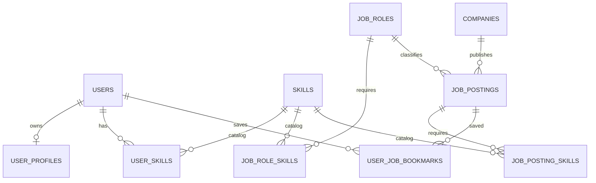

# AI Career Platform — D1 데이터베이스 설계 초안

> 상태: **DRAFT / NOT APPROVED / NOT DEPLOYED** · 기준일: 2026-11-06
>
> 이 문서는 실제 DB를 생성하지 않습니다. 기존 `poc/staging` PostgreSQL 18.1 컨테이너 및 Named Volume은 변경하지 않습니다.

## 1. 근거 및 범위

- 기존 PR #2 `docs/DATABASE.md`: Staging은 공유 통합 테스트용, 공통 Seed는 보존, 스키마 변경은 승인된 Migration으로 관리하며 **자동 배포에 Migration을 연동하지 않음**.
- `docs/ARCHITECTURE.md`: FastAPI Router → Service → Repository → PostgreSQL, 사용자·프로필·직무·기술·기업·채용공고 중심.
- `docs/AI_FEATURES.md`: 직무 매칭/Skill Gap/추천·RAG·Agent는 단계적 확장. 현재 ML 7종은 기획 범위.
- 실제 화면 72개, 요구사항·API 계약·ERD 미확정. 따라서 **테이블 20~25개를 확정 수치로 사용하지 않음**.

## 2. 최소 핵심 테이블 후보 (10개, 전부 승인 전)

| 테이블 | 목적 | PK | 주요 FK / UNIQUE | 비고 |
|---|---|---|---|---|
| `users` | 서비스 사용자 | `user_id` UUID | `email` UNIQUE | 이메일 정규화·탈퇴·인증 정책 검토 |
| `user_profiles` | 사용자 공개 프로필 | `user_id` UUID | FK users(1:1) | 민감 정보 최소화 |
| `companies` | 기업 기본 정보 | `company_id` UUID | 필요시 `external_source, external_id` UNIQUE | 수집 출처·사용권한 별도 정책 |
| `job_roles` | 표준 직무 분류 | `job_role_id` UUID | `code` UNIQUE | 기준 코드·버전 확정 필요 |
| `skills` | 표준 기술 분류 | `skill_id` UUID | `code` UNIQUE | 명칭 변경 대비 고정 코드 |
| `job_role_skills` | 직무 요구 기술 | (`job_role_id`, `skill_id`) | FK job_roles, skills | 요구 수준 정의 미확정 |
| `user_skills` | 사용자 보유 기술 | (`user_id`, `skill_id`) | FK users, skills | 근거·자기평가 구분 검토 |
| `job_postings` | 채용공고 | `job_posting_id` UUID | FK companies, job_roles | 만료일·출처·중복 처리 정책 필요 |
| `job_posting_skills` | 공고 요구 기술 | (`job_posting_id`, `skill_id`) | FK postings, skills | 우대/필수 여부 후보 |
| `user_job_bookmarks` | 사용자 공고 북마크 | (`user_id`, `job_posting_id`) | FK users, postings | MVP 범위 검토 필요 |

### ERD 초안 (논리적 관계만; 물리 DDL 아님)

## 3. 물리 설계 공통 결정 후보

- PostgreSQL 18.1, 별도 애플리케이션 스키마 `career` **설계 제안(미승인)**. 현재 사용자 정의 테이블 0개, 비시스템 스키마 `public` 1개 확인.
- 신규 PK는 UUID 후보; 일부 코드형 기준 데이터는 stable `code` 사용.
- 모든 시간은 DB에 `timestamptz`(UTC 기준) 저장, API 표현은 ISO 8601.
- 일반 테이블 `created_at` / `updated_at`, 필요한 경우 `deleted_at`; 삭제 정책은 개인정보 요구사항 검토 후 결정.
- 관계형 연결 테이블에 복합 PK와 FK 적용. FK 컬럼 인덱스는 실제 조회 패턴 확인 후 지정.
- `email`의 중복 판정(대소문자·공백·정규화), 인증 식별자, 사용자 삭제 처리 등은 **미확정**.
- UNIQUE/FK/CHECK/NOT NULL과 최소 권한을 우선. 인덱스 남발 금지.

## 4. 향후 확장 — 이번 DB 초기화 대상 아님

- 추천 기록·모델 버전·매칭 점수·Skill Gap 결과
- 이력서/파일 보관 메타데이터, 동의 이력, 감사 로그
- RAG 문서·Chunk·Embedding·검색 근거·접근 제어
- Agent 실행·Tool Calling 승인·비용 기록
- 채용 공고 수집 배치·외부 데이터 출처·품질 검증

확장 테이블은 요구사항 및 개인정보·수집권한 계약 확정 후 별도 Migration/PR.

## 5. D2 실행 전 승인 게이트

1. 실제 기능·유저 역할·화면/API 요구사항 매핑 검토
2. 기존 Staging DB의 스키마/테이블/계정 현황 **읽기 전용 조사**
3. PK/FK, NULL/UNIQUE, 삭제/변경 정책, 인덱스 초안 승인
4. Migration 도구 및 버전 규칙 결정 (예: Alembic; 아직 선택 전)
5. 기존 DB 백업·복구 검증과 Staging 영향 범위 합의
6. Reader/App/Migrator/Admin 역할 구분 및 비밀정보 관리
7. Seed가 멱등·가상 데이터임을 검증, CI는 별도 테스트 DB 사용
8. Migration은 자동 배포에서 실행하지 않음 (별도 승인 절차)

## 6. D1 단계 산출물과 상태

- [x] 기존 PR #2의 DB/아키텍처/AI·온보딩 정책 검토
- [x] MVP 10개 논리 테이블 후보 및 관계 초안
- [x] 기능↔테이블 추적 매트릭스 작성(근거 범위에서만 검토)
- [x] D1-9 격리 PostgreSQL 18.1에서 Migration SQL 실행 테스트 PASS
- [x] D1-10 검토·승인 패키지 문서화
- [ ] 실제 요구사항·화면·API와 매핑 **확정**
- [x] PostgreSQL 읽기 전용 실태 조사(테이블/스키마/역할 목록; 백업 및 DB 소유권은 별도 확인)
- [x] D1-5 물리 컬럼·제약조건 및 계정 권한 초안 작성
- [ ] 실제 서비스 요구사항/화면/API와 테이블 매핑·PM 승인
- [ ] D2 Migration/Seed/계정 실행 및 검증

**금지:** 이 문서를 확정 DDL로 취급하거나, 기존 `poc/staging` DB에 무승인 실행하지 않음.

## 7. D1-5 물리 컬럼 상세 설계 (제안 / 미승인)

아래는 **Migration 구현을 위한 설계 사양**이며 실행 가능한 SQL이 아닙니다. `UUID DEFAULT gen_random_uuid()`는 PostgreSQL 18에서 사용 가능한 기본 함수로 가정하되, 실행 전 버전/권한을 검증합니다. ID, 날짜, 상태값은 API 계약 확정 시 조정할 수 있습니다.

**공통 규칙:** `created_at timestamptz NOT NULL DEFAULT now()`, `updated_at timestamptz NOT NULL DEFAULT now()`는 실체 테이블(users, user_profiles, companies, job_roles, skills, job_postings)에만 적용하는 안. `updated_at`은 DB에서 자동 갱신되지 않으므로 애플리케이션 또는 트리거 중 **하나의 책임 주체를 결정**해야 합니다. 연결 테이블은 필요에 따라 `created_at`만 사용합니다.

| 테이블 | 컬럼 제안 (PK/FK/기본값/NULL 명시) | 추가 제약조건 및 메모 |
|---|---|---|
| `users` | `user_id uuid PK DEFAULT gen_random_uuid()`; `email varchar(254) NOT NULL`; `display_name varchar(100) NOT NULL`; `status varchar(20) NOT NULL DEFAULT 'active'` | `UNIQUE(email)`은 정규화된 소문자 이메일 저장을 전제로 한 **후보**. status CHECK `('active','disabled')`. 비밀번호/인증은 외부 IDP 여부 결정 전 설계 보류 |
| `user_profiles` | `user_id uuid PK/FK users.user_id`; `headline varchar(200) NULL`; `bio text NULL`; `location_text varchar(120) NULL` | 1:1. 프로필 내 개인정보/공개 범위 정책 필요 |
| `companies` | `company_id uuid PK DEFAULT gen_random_uuid()`; `name varchar(200) NOT NULL`; `website_url text NULL` | 회사명 중복 허용 가능. 외부 공급자 ID는 데이터 계약 체결 후 추가 |
| `job_roles` | `job_role_id uuid PK DEFAULT gen_random_uuid()`; `code varchar(64) NOT NULL UNIQUE`; `name varchar(160) NOT NULL` | 코드 대문자/대시 표준 결정 필요 |
| `skills` | `skill_id uuid PK DEFAULT gen_random_uuid()`; `code varchar(64) NOT NULL UNIQUE`; `name varchar(160) NOT NULL` | 동의어/표준화는 후속 테이블로 분리 |
| `job_role_skills` | `job_role_id uuid NOT NULL FK job_roles`; `skill_id uuid NOT NULL FK skills`; `importance smallint NULL` | `PK(job_role_id,skill_id)`; importance는 `CHECK(importance BETWEEN 1 AND 5)`(NULL 허용) |
| `user_skills` | `user_id uuid NOT NULL FK users`; `skill_id uuid NOT NULL FK skills`; `proficiency smallint NULL` | `PK(user_id,skill_id)`; proficiency는 `CHECK(proficiency BETWEEN 1 AND 5)`(NULL 허용); 자기평가/검증 근거 보류 |
| `job_postings` | `job_posting_id uuid PK DEFAULT gen_random_uuid()`; `company_id uuid NOT NULL FK companies`; `job_role_id uuid NULL FK job_roles`; `title varchar(240) NOT NULL`; `description text NULL`; `source_url text NULL`; `published_at timestamptz NULL`; `expires_at timestamptz NULL`; `status varchar(20) NOT NULL DEFAULT 'draft'` | `CHECK(status IN ('draft','published','closed'))`; 만료일 비교 `expires_at >= published_at`은 둘 다 NULL 아닐 때만 검사; URL 유효성은 API 계층 |
| `job_posting_skills` | `job_posting_id uuid NOT NULL FK job_postings`; `skill_id uuid NOT NULL FK skills`; `is_required boolean NOT NULL DEFAULT true` | `PK(job_posting_id,skill_id)` |
| `user_job_bookmarks` | `user_id uuid NOT NULL FK users`; `job_posting_id uuid NOT NULL FK job_postings`; `created_at timestamptz NOT NULL DEFAULT now()` | `PK(user_id,job_posting_id)` |

**FK 삭제 정책(제안):** 기본은 `ON DELETE RESTRICT/NO ACTION`으로 의도치 않은 삭제를 방지. 사용자가 실제 탈퇴할 때 관련 데이터 처리와 개인정보 보존 정책이 확정되기 전까지 `CASCADE`를 자동 선택하지 않습니다.

**인덱스 후보:** PK·UNIQUE는 PostgreSQL에서 자동 인덱스 생성. 조회 방향의 역방향 FK 인덱스 후보 `job_postings(company_id)`, `job_postings(job_role_id)`, `user_skills(skill_id)`, `job_role_skills(skill_id)`, `job_posting_skills(skill_id)`, `user_job_bookmarks(job_posting_id)`. `job_postings(status,published_at DESC)`는 실제 목록 API 쿼리 확인 후 결정합니다. 일반 FK 인덱스는 자동 생성되지 않으므로 확인이 필요합니다.

## 8. D1-5 Staging DB 실태 조사 결과 (2026-11-06)

사용자가 Staging PostgreSQL에 읽기 전용 SQL을 실행하여 아래 항목을 확인했습니다.

| 항목 | 확인된 값 | 해석 |
|---|---|---|
| 사용자 정의 테이블 | **0개** | 새 핵심 테이블과 테이블명 충돌 없음 |
| 비시스템 스키마 | `public` | `career` 스키마는 아직 없음 |
| 비시스템 역할 | `ai_career_poc` | LOGIN, SUPERUSER, CREATEDB, CREATEROLE=true |
| PostgreSQL | 18.1 (기존 배포 컨텍스트) | 데이터 삭제/재생성 명령 실행 금지 |

조회는 테이블 목록과 역할 속성을 확인했을 뿐 **DB 소유권, 기존 확장기능, 데이터베이스별 권한, 백업/복원 가능성, 타 DB의 존재 여부는 확인하지 않았습니다.**

## 9. D2 권한 모델과 적용 순서 (실행 전 초안)

| 역할 | 로그인 | 의도된 권한 | 금지 사항 |
|---|---|---|---|
| `career_reader` | YES | `CONNECT`, `USAGE ON SCHEMA career`, 필요한 테이블 `SELECT` | INSERT/UPDATE/DELETE/DDL |
| `career_app` | YES | `CONNECT`, `USAGE`, 필요한 테이블에만 SELECT/INSERT/UPDATE/DELETE | CREATE/ALTER/DROP, SUPERUSER |
| `career_migrator` | YES (승인된 실행용) | 소유 또는 Migration 적용에 필요한 `career` DDL 권한 | SUPERUSER 및 다른 DB에 대한 과도 권한 |
| `career_admin` | NOLOGIN 우선 제안 | `career` 스키마 관리·권한 설정 관리용 역할 | 일상 앱 연결 |
| `ai_career_poc` | 기존 계정 유지 | 초기 관리자/긴급 운영만 | FastAPI 런타임 계정으로 사용 금지 (전환 검증 후) |

**운영 주의:** 기존 FastAPI 컨테이너가 `ai_career_poc`으로 연결하는지 아직 확인하지 않았습니다. 최소 권한 계정 생성만으로 기존 연결이 변경되는 것은 아니며, 향후 런타임 계정 전환은 배포 설정·비밀값·연결 테스트를 포함한 별도 승인 작업입니다.

**D2 실행 순서 후보**
1. Staging 백업 생성, 복원 경로/권한 검증 및 현 DB 연결 상태 확인.
2. 계정 생성 전 보안 기본값 검토: `public` CREATE 권한, 신규 `career` 스키마 소유자, `search_path`, DB별 CONNECT 권한.
3. `career_admin`/Migrator 역할과 `career` 스키마를 최소 권한으로 생성.
4. 승인된 Migration 파일을 **기록된 1회 절차**로 적용, 스키마 버전 확인.
5. Reader/App 권한을 명시적 GRANT + 향후 테이블의 `ALTER DEFAULT PRIVILEGES`(실제 객체 생성 소유자 기준)로 설정.
6. 테스트용 가상 Seed를 버전 관리·멱등 적용; 외래키/건수/중복 확인.
7. 실제 Reader 읽기 성공·쓰기 실패, App CRUD 성공·DDL 실패, Migrator DDL 통제, API 연결 검증.
8. 자동 배포와 DB Migration 분리 유지, 실행 증빙과 롤백/복구 절차 기록.

**보안:** 비밀번호를 GitHub·PR·채팅·터미널 로그에 인라인 출력하지 않습니다. 단순히 환경변수에 저장하더라도 호스트/컨테이너 접근 권한을 점검해야 하며, 가능하면 권한이 통제된 secret 관리 수단을 사용합니다.

## 10. D1 PM 승인 전 남은 미결정

- 인증 방식(외부 IdP/자체 로그인), 사용자 권한/관리자 모델
- MVP 실제 화면·API·사용자 스토리 매핑, 북마크 포함 여부
- 이메일 정규화/중복 처리, 사용자 계정 삭제·보존·동의 처리
- 기업/공고 데이터 출처 및 약관, 직무·기술 분류 코드 출처
- Seed 정확한 건수와 데이터 생성 규칙
- DB 소유권·백업·복원/마이그레이션 검증 방법
- PR #2의 운영 정책과 PR #5의 설계 문서가 모두 main에 반영되는 시점

**결론:** 이 문서는 D1 설계안이며, PM 검토와 D2 안전 게이트 통과 전까지 실제 DB 객체 생성 및 권한 변경을 승인한 문서가 아닙니다.

## 11. D1-10 심사 결과

- [기능↔테이블 추적표](REQUIREMENTS_MATRIX.md)
- [요구사항 원본 조사·승인 체크리스트](REQUIREMENTS_APPROVAL_CHECKLIST.md)
- [실행 증빙·D1 승인 및 D2 안전 게이트](D1_REVIEW_AND_APPROVAL.md)
- [격리 PostgreSQL 18.1 GitHub Actions PASS](https://github.com/ai-career-platform/ai-career-platform/actions/runs/42149590877)

**판정:** `D1_SQL_TEST=PASS` / `D1_SCHEMA_APPROVAL=HOLD` / `D2_EXECUTION=BLOCKED`. 요구사항/PM 승인과 백업·복원 검증 전 실제 Staging DDL·Seed·계정 생성 금지.
