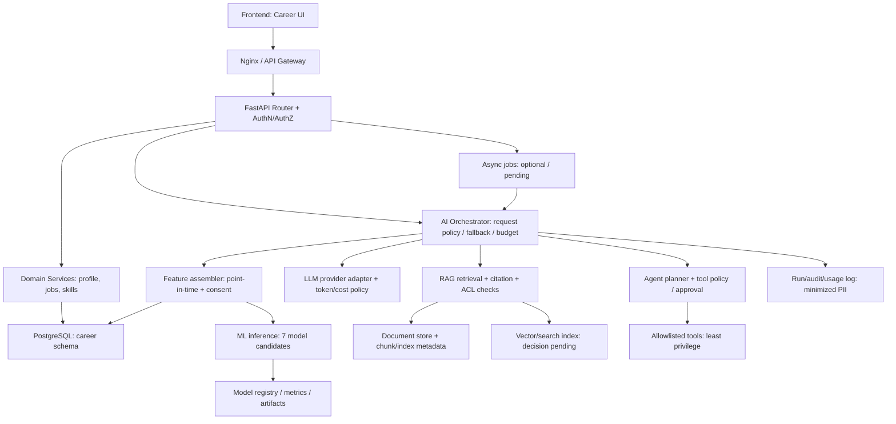
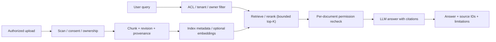

# S05 — AI·ML·LLM·RAG·Agent 통합 아키텍처 v0.1

> **상태: DESIGN DRAFT / NO MODEL IMPLEMENTED / NOT APPROVED** · 2026-11-06  
> 참조: [S02 전체 기능·화면·API 매핑](FULL_SCOPE_TRACEABILITY.md), [S03 전체 DB 모델](../database/FULL_DATABASE_MODEL.md), [S04 API 계약](API_CONTRACT.md), PR #2 `docs/AI_FEATURES.md`.  
> **범위:** 단기 프로젝트의 **전체 기능을 선설계**하고, 구현은 의존관계에 따라 단계적으로 진행한다. 여기의 ML 7종·LLM·RAG·Agent는 **기획 후보**, 검증된 모델·데이터셋·배포 완료 기능이 아니다.

## 1. 전체 목표와 설계 경계

- **사용자 가치:** 프로필·보유 기술·경력·희망 직무를 활용한 직무/공고 탐색, Skill Gap, 설명 가능한 추천, 근거 기반 문서 Q&A.
- **비AI 기본 기능 우선:** 가입/계정, 프로필, 직무/기술 검색, 기업·공고 목록이 AI 호출 실패와 무관하게 동작.
- **책임 분리:** 업무 API(FastAPI Router→Service→Repository), AI orchestration, 모델 추론/평가, RAG 검색·문서 처리, 승인 기반 Agent Tool 실행.
- **데이터 흐름:** 입력/피처의 시점·출처·허가 확인 → 모델 또는 규칙 기반 추론 → 결과 버전·설명·한계 기록 → API 계약에 맞춰 반환.
- **개인정보/권한:** 서비스 사용자 역할 및 리소스 소유권은 API와 저장소에서 검사. RAG의 문서·Chunk·출처에도 동일한 권한 경계 적용. 공개/기업/개인 영역 구분은 아직 PM 의사결정 필요.
- **인프라:** 현재 검증된 것은 `poc/staging` Docker Frontend/Backend/PostgreSQL 및 GHCR Pull형 Auto-CD. AI Worker/Queue/Object Storage/Vector Index/Model Serving은 **아직 선택·구현하지 않음**.

## 2. 전체 논리 아키텍처

> 화살표는 **미래 설계**를 설명하며 이 구성이 현재 Staging에 실행 중이라는 뜻이 아니다. Worker/Queue/Vector Store는 필요성과 기간·비용 측정 뒤 선택할 수 있다.

## 3. ML 모델 7종: 목적·입출력·평가·최소 데이터 계약

| ID / 기능 | 모델/기능 후보 | 입력 후보 | 출력 및 저장 후보 | 오프라인 평가/게이트 후보 | 기본 대체 동작 |
|---|---|---|---|---|---|
| ML01 / F-015 | 직무·공고 적합도 | user_skills, job_role_skills, posting_skills, 목표 직무 | score + score_semantics + version → `match_evaluations` | holdout ranking/MAE 등 **실제 레이블 확보 시 확정**, 편향·세그먼트 별 검사 | 공통 기술 교집합 등 **규칙 기반 설명 점수** |
| ML02 / F-017 | 개인화 랭킹 | 공개·허용 행동, 구직 의도, 공고 특징 | 상위 N개 추천·순위 → `recommendation_runs/items` | NDCG@K/MAP@K, 시간 분할, 오프라인→온라인 일치 | 최신/직무 기준 정렬된 공고 |
| ML03 / F-016 | Skill Gap 계산/분석 | 사용자 보유 기술, 목표 직무 요구 수준 | 부족 기술 목록·범위 → `skill_gap_assessments/items` | 전문가 정의 기준과 일치도, 사용자 확인 | 명시적 요구 수준 − 자기평가 수준 (불확실성 안내) |
| ML04 / F-025 | 사용자·직무 군집화 | 허용된 기술 벡터·집계 특징 | segment/code → `user_segments/assignments` | 군집 안정성·활용성·개인정보/공정성 평가 | 군집 결과 미노출 |
| ML05 / F-024 | 채용시장 추세 예측 | 출처가 허용된 기간별 채용 지표 | 예측 시계열·기간 → `market_forecasts` | 시간순 split/rolling backtest, MAE/sMAPE + baseline | 검증된 과거 관측치만 표시 |
| ML06 / F-017/025 | 행동 기반 추천 | 동의한 이벤트·조회/저장 정보 | 개인화 특성/후보 점수 (저장 정책 별도) | 오프라인 recall, 편향, 콜드스타트, 삭제 반영 | 비개인화 랭킹 |
| ML07 / F-025 | 이상 탐지 | 허가된 접속/데이터 품질·행동 집계 | anomaly flag/score → `anomaly_events` | 정밀도/재현율(레이블 확보 시), false positive review | 경고 비표시 + 운영 로그 |

**중요:** 모델 7종을 모두 각각 독립 서버/학습 파이프라인으로 분리할 필요는 없음. 단기 과제에서는 간단한 규칙/베이스라인을 먼저 구현하고, 데이터와 평가지표가 확보되는 모델만 ML로 확장하는 방식을 제안한다.

### 3.1 데이터 계약 필수 컬럼 (모델/피처 공통)

- `entity_id`, `event_time`, `observed_at`/데이터 이용 가능 시각, `source_id`, `consent_scope` 또는 사용 권한 검증 결과, `feature_version`, `dataset_version`, `split_id`.
- 라벨/목표변수는 정의와 관측 가능 시점, 결측/중복 처리, 대상 집계 단위를 명시.
- 학습·평가 분리: **미래 시점 데이터 누수 금지**, 동일 사용자·공고의 중복/near-duplicate 데이터 분리, 과도한 통계 피처 leakage 검사.
- 민감정보가 직접 들어가는 피처는 기본적으로 제외하고 사용 목적·근거·접근권한을 검증. 필요하지 않은 실사용자 이력서 원문을 모델 훈련 데이터로 수집하지 않음.
- 외부 채용 데이터의 라이선스·수집/활용 범위, 사용자 삭제/동의 철회 후 재학습/색인 제거 대응을 기록.

### 3.2 모델 등록·배포 계약

`model_versions(model_code, version, artifact_ref, approved_at)` 및 `model_evaluations(model_version_id, dataset_ref, metric_code, metric_value)` 후보 사용. **모델 및 데이터 아티팩트 해시·평가 기간·기준선·제약·승인 기록**을 연결해야 한다. 개선 모델의 실제 배포는 승인 게이트를 거치며 자동 앱 배포와 별도 추론 설정/버전 관리가 필요할 수 있음.

## 4. LLM 문서 분석

- **F-020** `POST /api/v1/document-analyses`: 문서 소유권/용량/MIME/파일 시그니처/악성 검사 후 작업 생성(202) → 권한 확인된 텍스트 추출 → 프롬프트 템플릿 버전 기록 → LLM 호출 → 스키마 검증된 결과 저장.
- 결과 계약 후보: `analysis_id`, `status`, `model_id`, `prompt_template_version`, `sections[]`, `warnings[]`, `source_document_id`, `created_at`, `usage_ref`.
- 환각·과도한 단정·편견에 대한 품질 평가. 추출된 문서 내용은 **신뢰할 수 없는 데이터**이며 Tool 실행 지시로 승격하지 않음.
- 민감정보 최소화, 공급자별 데이터 사용·보존 정책과 전송 허가 확인, 입력/출력 원문 로깅 제한.
- 실패 시 `status=failed` + 재시도 정책/추적 ID를 제공하고 기본 프로필/공고 API로 오류 전파 금지.

## 5. RAG: 수집→권한→검색→답변·근거

- **F-019** `user_documents`: 보관 위치·SHA·소유권·공개범위; 문서 파일은 권한 통제된 별도 저장소 후보.
- **F-021/F-022** `document_chunks`, `retrieval_runs`, `retrieval_citations`: 청크 인덱스/원본 버전/근거 추적. 소유권·조직·문서 접근 범위에 따른 검색 후보 제한.
- **검색 계약 후보**: `query`, `filters`, `max_results` → `chunk_id`, `document_id`, `source_revision`, `ranking_score`; 인용은 실제 접근 가능한 원본 단위만 반환.
- **보안:** Retrieval에서 허용된 Chunk만 선택하고 **답변 생성 직전에도 권한 재검사**. 인덱스의 검색 결과가 최신 ACL을 우회하지 못하도록 함.
- **정합성:** 문서 삭제/철회/수정 시 인덱스 폐기 또는 재색인 및 기존 인용/사용 로그 보존 정책을 명시.
- **평가:** retrieval Recall@K/Precision@K, citation precision, groundedness, no-answer 판단, 문서 권한 누출 테스트. 대표 질문·정답·근거로 Golden Fixture 구축.
- **저장소 결정 대기:** PostgreSQL + pgvector vs 외부 인덱스. 기술 선택 전 실제 문서 수/크기/비용/운영 복잡성 비교.

## 6. Agent: 상태·승인·실행 계약

| 단계 | 입력 | 수행 조건 | 기록/결과 |
|---|---|---|---|
| Create run | `workflow_code`, `input_ref`, authenticated user | 사용자 권한·workflow allowlist·예산 | `agent_runs`, 상태 `queued` |
| Plan / propose tools | 제한된 계획과 tool_code | 외부 문서/LLM 지시는 신뢰하지 않음 | 의도·파라미터 해시·권한 범위 |
| Policy gate | 사용자/도구/리소스/tenant | 읽기/변경/외부 전송 위험도별 권한 | `agent_tool_approvals` 필요 여부 |
| Human approval | `approval_id`, 결정 | **실제 사용자 행동에 의한 승인**, 실행 범위·만료/재사용 규칙 | approver·timestamp·decision |
| Execute | 승인된 tool + 제한된 인수 | allowlist, timeout, retries, rate/cost limit, idempotency | `agent_tool_calls`, 결과 식별자 |
| Finalize | tool result, summaries | 민감정보/내부 오류 제거, 감사기록 | `agent_runs.status` + 최종 결과 |

**원칙:** Tool 실행에 필요한 별도 권한을 주지 않고 관리자 DB 접속/호스트 SSH/비밀키를 Agent에 전달하지 않는다. 변경·삭제·메시지 전송 등 부작용은 승인 범위를 확인한 뒤 실행. Prompt Injection과 도구 응답의 명령 오염 방지, 비밀정보 마스킹, 사용자별 리소스 접근 통제를 테스트한다.

## 7. S04 API ↔ S03 DB ↔ ML/RAG/Agent 계약 매핑

| F-ID | API 제안 | 데이터 엔터티(후보) | 핵심 검증 |
|---|---|---|---|
| F-015 | `POST /api/v1/matches/evaluate` | `match_evaluations`, `model_versions`, `user_skills`, `job_posting_skills` | 소유자, 의미 있는 점수, 버전, 오차/편향 |
| F-016 | `POST /api/v1/skill-gaps/analyze` | `skill_gap_assessments/items`, `job_role_skills`, `user_skills` | 기준 수준·목표직무·누락기술 설명 |
| F-017/018 | `GET /api/v1/recommendations/jobs`, feedback | `recommendation_runs/items`; **feedback 이력 엔터티 누락** | 개인화 동의·정렬·model/version·피드백 소유권 |
| F-019/020 | documents / analyses | `user_documents`, `document_analyses` | 업로드 검증·파일 보존·LLM 실패 |
| F-021/022 | knowledge/search, knowledge/answer | `document_chunks`, `retrieval_runs/citations` | tenant/doc ACL·정확한 인용·권한 철회 |
| F-023 | agent-runs + approvals | `agent_runs/tool_calls/approvals` | 실제 승인·타임아웃·비용·중복 실행 |
| F-024 | market-trends | `data_sources`, `market_observations/forecasts` | 출처 허가·시간 분할·집계 오류 |
| F-025/026 | insights/admin/models | `behavior_events`, `segments`, `anomaly_events`, `model_versions/evaluations` | 동의·집계 익명화·모델 지표·운영권한 |
| F-028 | admin/audit, admin/ai-usage | `audit_events`, `ai_usage_records` | 관리자만 조회, 비용 단위, 비밀/PII 배제 |

**S03/S04 정합성 이슈(유지):** 탈퇴 요청, 추천 피드백 이력, 관리자 검수 테이블은 S03 후보 모델에서 빠져 있음. 실제 요구가 확정되면 추가/변경하고 스키마 버전·API 계약을 같이 갱신한다.

## 8. 보안·비용·성능·운영 정책 (후보 SLO)

| 영역 | 요구/보호 항목 | 테스트·완료 증빙 |
|---|---|---|
| AuthN/AuthZ | JWT/OIDC 결정 후 서버 검증, 사용자 소유권/tenant 격리 | 사용자 A→B 문서/모델결과/Agent 조회 403/404 |
| 프롬프트 주입 | 문서/검색 결과/Tool 출력 = 불신 데이터, 시스템 정책 우선 | 악성 문서·지시 무시 Fixture |
| 문서 보안 | 파일 크기/MIME/시그니처 검사, 악성 파일/경로 안전성 | 비허용 타입/과다 파일 413/415 및 접근거부 |
| 민감정보/로그 | 입력/출력 원문 기본 미기록, 비용·모델 ID·request ID 최소 기록 | 로그 검사, Secret 스캔, 동의 철회 처리 |
| 비용 | 사용자·작업/프로바이더별 토큰·호출 예산, 상한 초과 시 차단 | 예산/429·비용 미기록/재시도 테스트 |
| Latency | 동기 요청 타임아웃, 긴 작업은 202 + 상태 조회 | 부하·재시도·중단 시 중복 실행 점검 |
| Provider 장애 | LLM/임베딩/모델 제공자 장애 시 백오프/서킷브레이커 | 실패 주입에서 일반 CRUD 정상 |
| AI 품질 | baseline 비교, 시점 누수, 그룹별 공정성, 설명/근거 | 실험 결과·데이터 SHA·Fixture·모델 아티팩트 |
| 감사/승인 | Tool 허용 목록, 위험도별 인간 승인, 실행 결과 감사 | 승인 없는 write/tool 차단 |

**수치 SLO는 기획/부하 검증 후 결정.** 현재 타임아웃·비용 상한·동시성·예측 정확도 수치는 검증된 바 없으므로 임의로 PASS 표기하지 않는다.

## 9. 전체 기능 구현을 위한 빠른 단계 분해

| 단계 | 대상 | 우선 검증 |
|---|---|---|
| AI-00 | 데이터 권한/피처 계약/ML 공통 버전 인터페이스 | schema·훈련 누수·단위 테스트 |
| AI-01 | 규칙 기반 Skill Gap + 매칭 Baseline | 재현 가능한 Golden Fixture |
| AI-02 | ML01~03 모델 후보·평가/비교, 추천 API | 시간 분할, 지표, 사용자별 결과 |
| AI-03 | 문서 분석 LLM + RAG (권한 기반 인용) | 접근 제어/groundedness/비용 |
| AI-04 | Agent Tool Calling 및 승인 인터페이스 | approval gate·timeout·idempotency |
| AI-05 | ML04~07 고급 분석과 운영 대시보드 | 데이터 사용권한/오탐/집계 |
| AI-06 | 전체 E2E: Frontend → API → DB → ML/LLM | 성능/비용/보안/복구 증빙 |

이 순서는 **구현 순서 제안**이며 S01~S07 전체 설계는 선행한다. AI-03/04는 독립 mock/fixture 기반으로 병렬 개발 가능하다.

## 10. S05 승인 전 필수 의사결정 및 결과

- [x] 7개 ML 모델 후보의 데이터 입력/결과/평가/대체 흐름 정의
- [x] LLM 문서 분석·RAG ACL+인용·Agent 승인/실행 계약 초안
- [x] S03/S04와 데이터 모델·엔드포인트 매핑
- [x] 데이터 누수·공정성·비용·보안·장애 격리·테스트 기준 정리
- [ ] ML 데이터셋·레이블/출처·사용권한/평가지표 실제 확보
- [ ] 로그인/서비스 역할·문서 소유권·데이터 보존 정책 확정
- [ ] 모델·임베딩/벡터 인덱스/객체 저장소/Worker 선택
- [ ] 비용·Latency 상한·SLO 수치와 모델 평가 승인 기준 결정
- [ ] 정확한 화면/API 요구사항과 전체 테이블 구조 최종 승인

**판정:** `S05_AI_ARCHITECTURE_DRAFT=COMPLETE` / `AI_RUNTIME_IMPLEMENTATION=NOT_STARTED` / `S05_APPROVAL=PENDING` / `STAGING_DB_UNCHANGED`.

**다음 단계:** S06 개발·테스트·배포 운영 표준과 S07 전체 WBS/팀원 할당 계획을 작성하여 S01~S07 통합 설계 베이스라인 검토. PR #5는 Draft 상태 유지하고, 현재 자동 배포와 Staging DB는 변경하지 않음.
