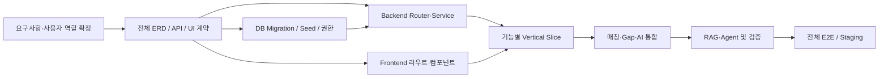

# AI Career Platform — 전체 기능·화면·API·데이터 통합 추적표 v0.1

> 상태: **CANDIDATE BASELINE / REQUIREMENTS REVIEW NEEDED** · 작성: 2026-11-06
>
> 사용자 요청에 따라 **전체 범위를 먼저 설계**하고, 구현만 단계적으로 진행합니다. 아래는 현 GitHub README 및 PR #2의 Architecture/AI Features에 근거한 **기능 후보**입니다. **실제 화면 72개, API 또는 전체 테이블 수가 확정되었다는 의미가 아닙니다.** 최종 기획서 및 Redmine 확인 전까지 모든 항목은 제안 상태입니다.

## 1. 공통 추적 규칙

- 기능 ID `F-xxx`, 화면 ID `UI-xxx`, API ID `API-xxx`, 데이터 도메인 `DB-xxx`를 동일 행에서 추적합니다.
- 아래 URL은 **API 설계 후보 경로**, 실제 구현된 엔드포인트가 아닙니다.
- `P0`: 필수 기반 후보, `P1`: 중심 기능 후보, `P2`: 고급·확장 후보. **우선순위는 PM 미승인**.
- `기존 10`은 PR #5의 시험된 초기 테이블 후보에서 재사용 가능하다는 뜻. 신규 테이블 이름은 **예상 대상**이며 DDL 확정 전입니다.
- 공통 기준: 모든 API의 인증·소유권·필터·페이지네이션·오류·타임존·감사 규칙을 API 계약에서 정의.

## 2. 기능 ↔ UI ↔ API ↔ DB 통합 매트릭스

| 기능 ID | 기능 / 흐름 (후보) | 화면 ID / 화면명 (후보) | API 경로 후보 | DB 범위 후보 | 우선순위 |
|---|---|---|---|---|---|
| F-001 | 회원 가입/인증 | UI-001 가입·로그인 | `POST /api/v1/auth/login` | `users`, identity/credential(미확정) | P0 |
| F-002 | 로그아웃·세션 | UI-002 계정 보안 | `POST /api/v1/auth/logout` | session/revocation(미확정) | P0 |
| F-003 | 계정·프로필 | UI-003 내 프로필 | `GET/PATCH /api/v1/me` | `users`, `user_profiles` | P0 |
| F-004 | 역할·접근권한 | UI-004 접근 제한 안내 | `GET /api/v1/me/permissions` | role/permission/assignment(미확정) | P0 |
| F-005 | 동의·탈퇴·보존 | UI-005 개인정보 설정 | `POST /api/v1/me/consents` | consent/deletion(미확정) | P0 |
| F-006 | 직무 탐색 | UI-006 직무 목록/상세 | `GET /api/v1/job-roles` | `job_roles` | P0 |
| F-007 | 기술 사전 | UI-007 기술 목록 | `GET /api/v1/skills` | `skills` | P0 |
| F-008 | 개인 보유 기술 | UI-008 나의 기술·숙련도 | `GET/PUT /api/v1/me/skills` | `user_skills` | P0 |
| F-009 | 목표 직무 선택 | UI-009 목표 직무 | `PUT /api/v1/me/target-roles` | target-role relation(미확정) | P1 |
| F-010 | 경력/프로젝트 이력 | UI-010 경력·프로젝트 | `GET/POST /api/v1/me/experiences` | experiences/projects(미확정) | P1 |
| F-011 | 기업 탐색 | UI-011 기업 목록/상세 | `GET /api/v1/companies` | `companies` | P0 |
| F-012 | 채용공고 탐색 | UI-012 공고 목록/상세 | `GET /api/v1/job-postings` | `job_postings`, `job_posting_skills` | P0 |
| F-013 | 공고 저장 | UI-013 저장한 공고 | `POST /api/v1/me/bookmarks` | `user_job_bookmarks` | P1 |
| F-014 | 직무·공고 요구기술 관리 | UI-014 요구 역량 비교 | `GET /api/v1/job-roles/{id}/skills` | `job_role_skills` | P0 |
| F-015 | 직무 적합도/매칭 | UI-015 적합도 결과 | `POST /api/v1/matches/evaluate` | match/model/prediction(미확정) | P1 |
| F-016 | Skill Gap 분석 | UI-016 부족 역량 | `POST /api/v1/skill-gaps/analyze` | gap result/targets(미확정) | P1 |
| F-017 | 맞춤 직무 랭킹 | UI-017 개인화 추천 | `GET /api/v1/recommendations/jobs` | recommendation/feedback(미확정) | P1 |
| F-018 | 추천 근거·피드백 | UI-018 추천 설명 | `POST /api/v1/recommendations/{id}/feedback` | explanation/feedback(미확정) | P1 |
| F-019 | 이력서 파일 업로드 | UI-019 문서 관리 | `POST /api/v1/documents` | documents/storage metadata(미확정) | P1 |
| F-020 | LLM 기반 문서 분석 | UI-020 문서 분석 결과 | `POST /api/v1/document-analyses` | analysis/artifact/model run(미확정) | P1 |
| F-021 | RAG 지식 검색 | UI-021 근거 기반 Q&A | `POST /api/v1/knowledge/search` | document/chunk/access(미확정) | P2 |
| F-022 | RAG 질의응답 | UI-022 커리어 Q&A | `POST /api/v1/knowledge/answer` | retrieval/citation/run(미확정) | P2 |
| F-023 | Agent 워크플로 | UI-023 AI 작업 내역 | `POST /api/v1/agent-runs` | agent/tool approval/action(미확정) | P2 |
| F-024 | 채용시장 추세 | UI-024 시장 분석 대시보드 | `GET /api/v1/market-trends` | observation/forecast(미확정) | P2 |
| F-025 | 군집·행동·이상탐지 | UI-025 분석 대시보드 | `GET /api/v1/insights` | segment/events/anomaly(미확정) | P2 |
| F-026 | 모델 버전·품질 | UI-026 ML 운영 현황 | `GET /api/v1/admin/models` | model version/evaluation(미확정) | P1 |
| F-027 | 운영 콘텐츠 검수 | UI-027 관리자 검수 | `GET /api/v1/admin/reviews` | moderation/review(미확정) | P2 |
| F-028 | 감사·AI 비용 기록 | UI-028 운영 감사 | `GET /api/v1/admin/audit` | audit/usage/cost(미확정) | P1 |
| F-029 | 기준 데이터 Seed·버전 | UI 없음 (운영 CLI) | `N/A` | migration/seed revision(미확정) | P0 |
| F-030 | Staging 건강상태·배포 검증 | UI 없음 (운영) | `GET /api/health` (기존 PoC) | 메타데이터 최소화 | P0 |

**주의:** 위 30행은 **검토용 기능 시나리오 30개**입니다. 화면 28개를 확정했다는 뜻도 아니고, UI ID가 확정된 화면 목록과 일치한다는 뜻도 아닙니다. 특히 사용자·기업 관리자·운영 관리자 구분, 자체/외부 인증, 동의 이력과 데이터 출처는 기획 원본 확보 후 보완해야 합니다.

## 3. 전체 DB 설계 준비 — 영역별 체크

| 데이터 그룹 | 현재 확인된 구조 | 추가 설계 후보 (미확정) | 주요 선행 결정 |
|---|---|---|---|
| 사용자/인증·권한 | `users`, `user_profiles` | identity, sessions, roles, consents, profile visibility | 외부 IdP/자체 인증, RBAC |
| 경력·역량 | `skills`, `user_skills` | experiences, projects, target roles, evidence | 경력·숙련도 데이터 사양 |
| 기업·채용 | `companies`, `job_roles`, `job_postings`, 두 skills 관계 | source, ingest runs, posting duplicates | 외부 데이터 권리/공고 중복 |
| 개인화·매칭 | 기초 관계만 존재 | model versions, predictions, explanations, feedback, gap assessments | 모델 계약 및 버전 관리 |
| 문서·RAG·Agent | 현재 없음 | documents, chunks, citations, retrieval runs, tool approvals, agent runs | 보관/검색/권한/비용 |
| ML·운영 | 현재 없음 | training/evaluation/metrics, audit events, usage | 성능 지표, 보존, 민감정보 |

**전체 ERD는 각 그룹의 확정 요구사항을 반영해 작성**하며, 처음부터 임의의 45~65개 테이블을 확정하지 않습니다. PostgreSQL의 10개 테이블 DDL 검증 결과는 재사용하지만 전체 스키마 적용 완료로 간주하지 않습니다.

## 4. 병렬 개발을 위한 의존성

실행은 분리 가능합니다. 예를 들어 UI 디자인과 API mock은 DB Migration 전에 병렬 진행할 수 있지만, **API/화면/테이블 계약을 먼저 합의**해야 재작업을 줄일 수 있습니다.

## 5. 승인 게이트와 다음 작업

- [x] 전체 범위 설계 우선 원칙 반영
- [x] 기존 10개 DB 후보를 전체 시스템 일부로 재배치
- [x] 기능 ↔ 화면 ↔ API ↔ DB 후보 매핑 초안 작성
- [ ] 실제 기획/Redmine 기능·화면 원본 대조
- [ ] 사용자 역할, 인증/인가, 개인정보·출처 등 범위 결정
- [ ] **전체 테이블/컬럼 ERD 및 전체 API 계약** 작성
- [ ] WBS·담당자·수용기준과 통합 테스트 계획 승인
- [ ] 전체 설계 베이스라인 승인 후 증분 구축

**다음 산출물:** `FULL_DATABASE_MODEL.md` 및 `API_CONTRACT.md` 초안. 이 문서의 후보를 실제 요구사항인 양 확정하여 Staging에 적용하지 않는다.
