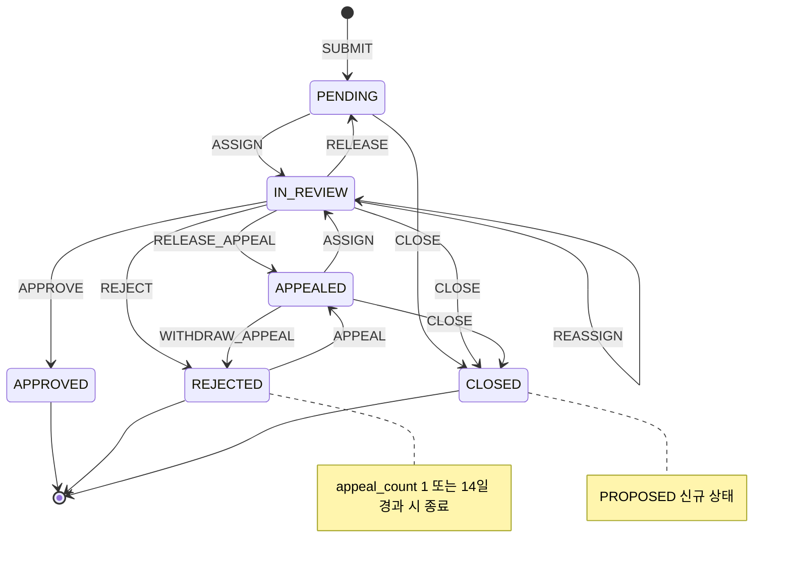

# T80 — 운영 콘텐츠 검수 상태 모델

> 상태: DRAFT / REVIEW_REQUIRED (PR #145 후속 보완) · 기능 추적: F-027 · 정책: [MODERATION_POLICY.md](MODERATION_POLICY.md) · 구현 계약: [MODERATION_IMPLEMENTATION_CONTRACT.md](MODERATION_IMPLEMENTATION_CONTRACT.md)
> **PM 승인: 미완료.** 아래 상태·전이는 모두 설계 후보다. 등급 표기는 정책 문서 §0을 따른다.
> 이 문서의 상태 표·전이표·Mermaid가 서로 맞는지는 `docs/admin/test_moderation_state_model.py`가 검사한다.

## 1. 모델 원칙

- 검수 단위는 **검수 건(case)** 하나다. 같은 콘텐츠라도 계기(게시 전, 신고, 만료 등)가 다르면 새 건을 만든다.
- **결정이 끝난 건은 다시 열지 않는다.** 승인된 콘텐츠를 다시 봐야 하면(신고·만료) 새 건(`trigger=REPORT|EXPIRY|SOURCE_CHANGE`)을 연다. 그래서 `APPROVED → IN_REVIEW` 같은 역전이는 없고, 결정 이력이 그대로 남는다.
- 이의제기는 같은 건 안에서 1회만 한다. **`appeal_count`는 이의제기 접수(T08) 시점에 0 → 1**로 오르고, 재검토 배정·철회로 바뀌지 않는다. 이의제기 재검토 결과가 최종이다.
- 자동 검증 실패(입력 거부)는 검수 건을 만들지 않는다(정책 §2.4).
- 처리 기한을 넘겨도 상태는 자동으로 바뀌지 않는다(자동 승인·반려 없음).

## 2. 상태

| 상태 | 의미 | 종료 | 등급 |
|---|---|---|---|
| PENDING | 접수됨, 담당자 없음 | 아니오 | REVIEW-PROPOSED |
| IN_REVIEW | 담당 관리자가 검수 중 (최초 검수 또는 이의제기 재검토) | 아니오 | REVIEW-PROPOSED |
| APPROVED | 승인. 게시 전 건이면 공개 허용, 게시 후 건이면 게시 유지 | 예 | REVIEW-PROPOSED |
| REJECTED | 반려. 게시 전 건이면 비공개 유지, 게시 후 건이면 게시 중단. `appeal_count=0`이고 결정 후 14일 이내일 때만 이의제기 가능 | 조건부 | REVIEW-PROPOSED |
| APPEALED | 이의제기 접수, 재검토 담당자 없음 | 아니오 | REVIEW-PROPOSED |
| CLOSED | 결정 없이 종료 (요청 철회, 대상 삭제, 새 건으로 대체) | 예 | PROPOSED |

PENDING~APPEALED 5개는 PR #145 후보 이름을 그대로 쓴다. CLOSED만 이번에 새로 **제안**하는 상태이며 확정 코드가 아니다.
상태가 아닌 건 속성(`trigger`, `priority`, `assignee_id`, `first_decider_id`, `appeal_count`, `version`, `due_at`, `close_reason`)은 [구현 계약 §2](MODERATION_IMPLEMENTATION_CONTRACT.md)에 정의한다.

## 3. 전이표

Actor 표기: `system`(서버), `owner`(콘텐츠 소유자·게시 요청자), `reporter`(신고자), `admin`(검수 권한 관리자), `assignee`(그 건의 담당 관리자).
Guard의 `not self`는 **담당·결정 관리자 ≠ 콘텐츠 소유자·제출자**, `not first_decider`는 **최초 결정자와 다른 관리자**를 뜻한다. 모든 변경은 서버가 권한·상태·version을 다시 확인한다.

| ID | From | Event | To | Actor | Guard | 등급 |
|---|---|---|---|---|---|---|
| T01 | [*] | SUBMIT | PENDING | system, owner, reporter | 검수 대상 유형이고 대상이 존재; 같은 (대상, trigger)의 열린 건이 있으면 새로 만들지 않고 기존 건 반환 | REVIEW-PROPOSED |
| T02 | PENDING | ASSIGN | IN_REVIEW | admin | not self; version 일치 | PROPOSED |
| T03 | IN_REVIEW | REASSIGN | IN_REVIEW | admin | 새 담당자도 admin이고 not self; appeal_count == 1이면 not first_decider; version 일치 | PROPOSED |
| T04 | IN_REVIEW | RELEASE | PENDING | assignee, admin | appeal_count == 0; version 일치 | PROPOSED |
| T05 | IN_REVIEW | RELEASE_APPEAL | APPEALED | assignee, admin | appeal_count == 1 (재검토 담당 해제); version 일치 | PROPOSED |
| T06 | IN_REVIEW | APPROVE | APPROVED | assignee | not self; appeal_count == 1이면 not first_decider; version 일치 | REVIEW-PROPOSED |
| T07 | IN_REVIEW | REJECT | REJECTED | assignee | not self; appeal_count == 1이면 not first_decider; reason_code 필수, OTHER면 메모 필수; version 일치 | REVIEW-PROPOSED |
| T08 | REJECTED | APPEAL | APPEALED | owner | appeal_count == 0; 결정 후 14일 이내; appeal_count를 1로 올림; version 일치 | REVIEW-PROPOSED |
| T09 | APPEALED | ASSIGN | IN_REVIEW | admin | not self; not first_decider; appeal_count 변경 없음; version 일치 | REVIEW-PROPOSED |
| T10 | PENDING | CLOSE | CLOSED | owner, system | owner 요청 철회 또는 대상 삭제·대체 | PROPOSED |
| T11 | IN_REVIEW | CLOSE | CLOSED | system | 대상 삭제·대체만 (검수 중 철회는 불가) | PROPOSED |
| T12 | APPEALED | CLOSE | CLOSED | system | 대상 삭제·대체만 | PROPOSED |
| T13 | APPEALED | WITHDRAW_APPEAL | REJECTED | owner | 이의제기 철회; 반려 결정 유지; appeal_count 1 유지(재신청 불가); version 일치 | PROPOSED |

`first_decider_id`는 T06·T07이 appeal_count == 0일 때 처음 기록하고 이후 바꾸지 않는다.

### 허용하지 않는 전이 (모두 409)

| 시도 | 이유 | 오류 (기존 카탈로그) |
|---|---|---|
| APPROVED → 어떤 상태든 | 결정 완료. 다시 보려면 새 건 | `APPROVAL_CLOSED` |
| CLOSED → 어떤 상태든 | 종료 | `APPROVAL_CLOSED` |
| REJECTED(appeal_count=1) → APPEALED | 이의제기 1회 제한 (재검토 후 반려, 이의제기 철회 후 모두 해당) | `APPROVAL_CLOSED` |
| REJECTED(결정 후 14일 초과) → APPEALED | 기한 경과 | `APPROVAL_CLOSED` |
| PENDING·APPEALED → APPROVED/REJECTED | 담당 없이 결정 불가 | `CONFLICT` |
| version 불일치 (동시 처리) | 다른 관리자가 먼저 바꿈 | `CONFLICT` |

## 4. 상태 다이어그램

## 5. 시나리오별 경로

| 시나리오 | 경로 |
|---|---|
| 게시 전 승인 | SUBMIT → ASSIGN → APPROVE |
| 게시 전 반려 → 이의제기 → 승인 | SUBMIT → ASSIGN → REJECT → APPEAL(appeal_count=1) → ASSIGN(다른 관리자) → APPROVE |
| 이의제기 철회 | … → REJECT → APPEAL → WITHDRAW_APPEAL → REJECTED (재신청 409) |
| 이의제기 후 다시 반려 (최종) | … → APPEAL → ASSIGN → REJECT. 이후 APPEAL은 409 |
| 승인 후 신고 | 기존 건은 APPROVED 그대로, **새 건** SUBMIT(trigger=REPORT) → … |
| 같은 대상 중복 신고 | 열린 REPORT 건이 있으면 그 건을 반환하고 신고 수만 늘린다 (구현 계약 §2.3) |
| 담당자 변경 | REASSIGN (IN_REVIEW 유지) 또는 RELEASE/RELEASE_APPEAL 후 다른 관리자가 ASSIGN |
| 관리자 1명 + 자기 콘텐츠 | ASSIGN이 not self로 막혀 PENDING 유지 → `needs_other_admin` 표시·기한 경고 (**HOLD**) |
| 동시 결정 | 먼저 커밋한 결정만 반영, 나중 요청은 version 불일치로 409 |
| 검수 중 대상 삭제 | system CLOSE (close_reason=TARGET_DELETED). 서비스 경로는 삭제 전에 닫고, CASCADE 경로는 DB 트리거가 닫는다 (구현 계약 §2.1) |
| 결정된 건의 대상 삭제 | 상태 그대로 (APPROVED·REJECTED 유지), `target_id` 스냅샷으로 이력 보존 |
