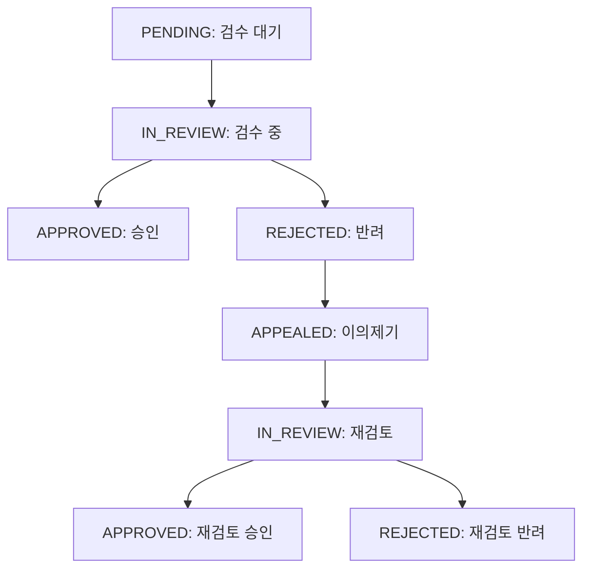

# T80 — 운영 콘텐츠 검수 상태 다이어그램

> 상태: DRAFT / REVIEW_REQUIRED
> 기능 추적: F-027
> 정책 참조: MODERATION_POLICY.md
> PM 승인: 미완료

## 상태 전이 후보

## 미확정 사항

- 이의제기 재검토 후 최종 종료 조건
- 반복 이의제기 허용 여부
- 승인된 콘텐츠의 재검수 여부
- 상태 변경 권한과 담당자 구분
- 처리 기한 및 지연 시 대응
- 실제 API 상태 코드와의 매핑

위 상태 흐름은 정책 초안으로,
PM 및 관련 담당자의 리뷰 후 확정한다.
