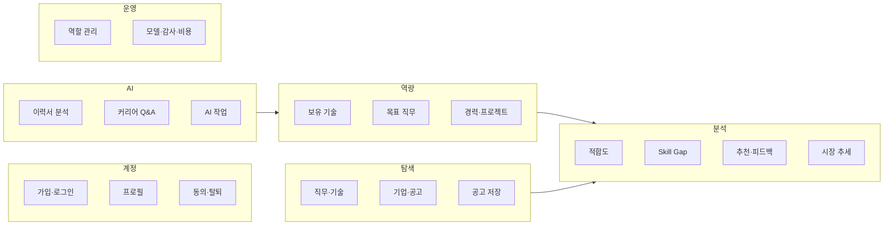

# 프로젝트 개요

## 1. 프로젝트명

**AI Career Platform** (AI 기반 커리어 플랫폼)

## 2. 목적

구직자가 자신의 기술과 목표 직무를 등록하면 다음 세 가지를 얻을 수 있게 합니다.

1. 목표 직무에 비해 **부족한 기술**(Skill Gap)
2. 채용공고별 **적합도 점수와 근거**
3. 프로필에 맞는 **채용공고 추천**

AI는 이력서 분석과 커리어 질문 답변을 도와, 사용자가 직접 입력할 정보를 줄입니다.

## 3. 배경

- 구직자는 공고마다 요구 기술을 직접 읽고 자신과 비교해야 합니다. 비교 기준이 없어 어떤 기술을 먼저 준비할지 판단하기 어렵습니다.
- 일반 채용 사이트의 추천은 이유를 알려주지 않아 신뢰하기 어렵습니다.
- 이 프로젝트는 **직무별 요구 기술을 표준 목록으로 관리**하고, 사용자의 보유 기술과 같은 척도(1~5)로 비교해 차이와 근거를 보여줍니다.

## 4. 범위

### 4.1 1차 릴리스 포함

| 영역 | 내용 |
|---|---|
| 계정 | 이메일 가입·로그인, 프로필, 약관 동의, 탈퇴 |
| 역량 | 보유 기술·숙련도, 목표 직무(최대 3개), 경력·프로젝트 |
| 탐색 | 직무, 기술, 기업, 채용공고 조회·검색, 공고 저장 |
| 분석 | 적합도 점수, Skill Gap, 맞춤 공고 추천, 추천 피드백 |
| AI | 이력서 업로드·분석, 근거 기반 커리어 Q&A |
| 운영 | 관리자 역할, 모델 버전·평가, 감사 기록, AI 사용량 |

### 4.2 1차 릴리스 제외

| 항목 | 제외 이유 | 이후 일감 |
|---|---|---|
| 기업 담당자 계정·공고 게시 | 1차 사용자는 구직자와 운영자로 한정 | T121~T127 |
| 운영 콘텐츠 검수 | 사용자가 공개 게시하는 콘텐츠가 없음 | T80~T82 |
| 알림·수신 설정 | 핵심 흐름에 필요하지 않음 | T95~T97 |
| 지원 현황 관리 | 제품 목적(분석·추천) 밖 | T101~T103 |
| 학습경로 추천 | 학습 콘텐츠 데이터 출처 미정 | T131~T136 |
| 외부 채용 사이트 공고 수집 | 데이터 이용 권한 미확보. 1차는 가상 데이터 사용 | T61~T64 |

## 5. 사용자

| 사용자 | 설명 | 주요 목표 |
|---|---|---|
| 방문자 | 로그인하지 않은 사용자 | 직무·기업·공고 둘러보기, 가입 |
| 구직자 | 가입한 개인 사용자 | 기술 등록, Skill Gap 확인, 적합한 공고 찾기 |
| 운영 관리자 | 서비스 운영 담당자 | 역할 관리, 모델 품질·감사 기록·AI 비용 확인 |

## 6. 기능 구성

| 분류 | 요구사항 문서 | 요구사항 수 |
|---|---|---:|
| 계정·인증·개인정보 | [FR-ACC](../functional/ACCOUNT.md) | 7 |
| 프로필·역량 | [FR-PRF](../functional/PROFILE.md) | 4 |
| 직무·기업·공고 | [FR-JOB](../functional/JOB.md) | 7 |
| 분석·추천 | [FR-ANL](../functional/ANALYSIS.md) | 5 |
| AI | [FR-AI](../functional/AI.md) | 4 |
| 운영 관리 | [FR-ADM](../functional/ADMIN.md) | 6 |
| 공통 화면 | [FR-CMN](../functional/COMMON.md) | 4 |
| 비기능 | [NFR](../non-functional/NON_FUNCTIONAL.md) | 17 |

## 7. 제약 사항

- 기술 구성: Frontend → Nginx → FastAPI → PostgreSQL (기존 Staging 구성 유지)
- 1차 기업·공고 데이터는 팀이 만든 **가상 데이터**만 사용합니다.
- 적합도·추천 점수는 1차에 **규칙 기반**으로 계산합니다. 머신러닝 모델은 이후 같은 화면에 교체 적용합니다.
- 공용 Staging DB 변경은 PM 승인 후에만 진행합니다.

## 8. 용어

| 용어 | 뜻 |
|---|---|
| 숙련도 | 기술을 다루는 수준. 1 입문 · 2 기초 · 3 실무 가능 · 4 능숙 · 5 전문가 |
| 요구 수준 | 직무·공고가 요구하는 숙련도 (같은 1~5 척도) |
| Skill Gap | 기술별 `요구 수준 − 보유 숙련도` (0 미만은 0) |
| 적합도 점수 | 0~100점. 보유 기술이 요구 기술을 얼마나 충족하는지 나타냄. **합격 확률이 아님** |
| 계산 기준 | 점수를 계산한 규칙 또는 모델의 버전 |
