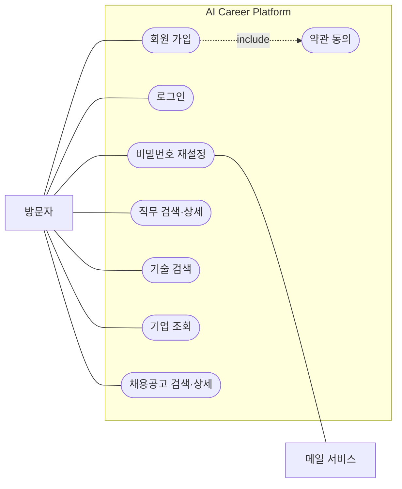
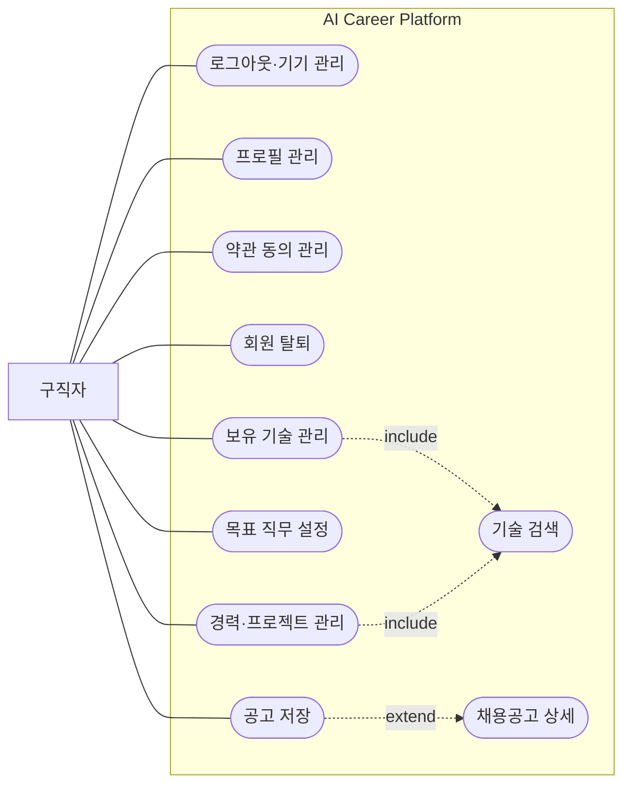
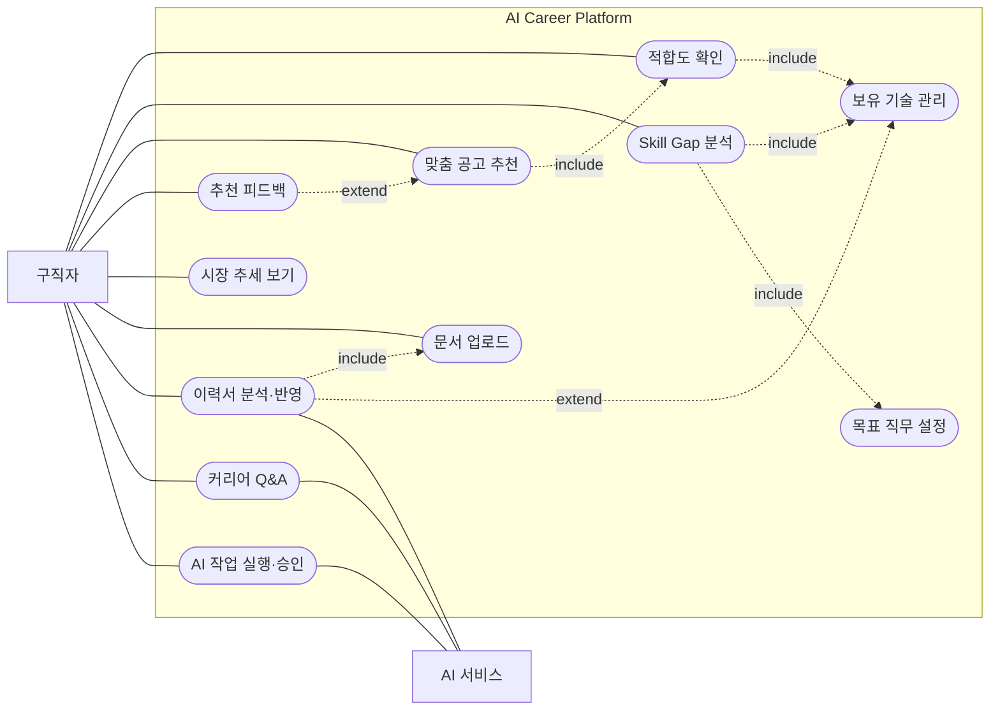
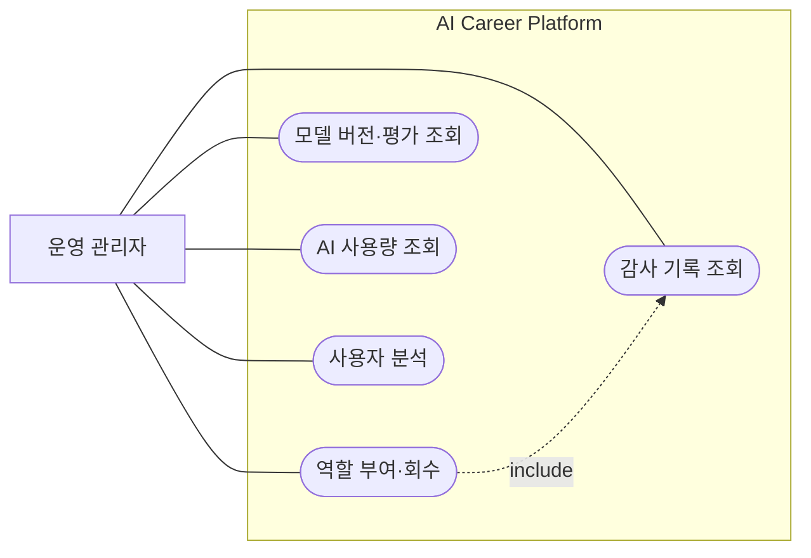
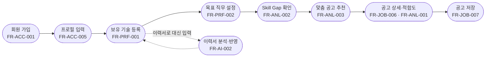

# 유스케이스 다이어그램

[목차로](../README.md)

Mermaid에는 유스케이스 전용 문법이 없어 `flowchart`로 그립니다. 사각형이 액터, 둥근 타원이 유스케이스, 큰 상자가 시스템 경계입니다. 점선 화살표는 `include`(항상 함께 수행)와 `extend`(조건에 따라 추가 수행) 관계입니다.

## 1. 액터

| 액터 | 설명 |
|---|---|
| 방문자 | 로그인하지 않은 사용자 |
| 구직자 | 가입한 사용자. 방문자가 할 수 있는 일을 모두 할 수 있음 |
| 운영 관리자 | 관리자 역할이 있는 구직자 |
| AI 서비스 | 문서 분석·답변 생성을 맡는 외부 시스템 |
| 메일 서비스 | 비밀번호 재설정 메일을 보내는 외부 시스템 |

## 2. 다이어그램

한 장에 모두 그리면 선이 겹쳐 읽기 어려워 액터별로 나눴습니다. 구직자는 방문자의 유스케이스를, 운영 관리자는 구직자의 유스케이스를 모두 쓸 수 있습니다(일반화).

### 2.1 방문자

### 2.2 구직자 — 계정·역량·탐색

### 2.3 구직자 — 분석·AI

### 2.4 운영 관리자

## 3. 핵심 흐름 — 가입부터 첫 분석까지

## 4. 유스케이스 ↔ 요구사항

| 유스케이스 | 액터 | 요구사항 |
|---|---|---|
| 회원 가입 | 방문자 | FR-ACC-001 |
| 로그인 | 방문자 | FR-ACC-002 |
| 로그아웃·기기 관리 | 구직자 | FR-ACC-003 |
| 비밀번호 재설정 | 방문자, 메일 서비스 | FR-ACC-004 |
| 프로필 관리 | 구직자 | FR-ACC-005 |
| 약관 동의 관리 | 구직자 | FR-ACC-006, FR-CMN-003 |
| 회원 탈퇴 | 구직자 | FR-ACC-007 |
| 직무 검색·상세 | 방문자 | FR-JOB-001, FR-JOB-002 |
| 기술 검색 | 방문자 | FR-JOB-003 |
| 기업 조회 | 방문자 | FR-JOB-004 |
| 채용공고 검색·상세 | 방문자 | FR-JOB-005, FR-JOB-006 |
| 공고 저장 | 구직자 | FR-JOB-007 |
| 보유 기술 관리 | 구직자 | FR-PRF-001 |
| 목표 직무 설정 | 구직자 | FR-PRF-002 |
| 경력·프로젝트 관리 | 구직자 | FR-PRF-003, FR-PRF-004 |
| 적합도 확인 | 구직자 | FR-ANL-001 |
| Skill Gap 분석 | 구직자 | FR-ANL-002 |
| 맞춤 공고 추천 | 구직자 | FR-ANL-003 |
| 추천 피드백 | 구직자 | FR-ANL-004 |
| 시장 추세 보기 | 구직자 | FR-ANL-005 |
| 문서 업로드 | 구직자 | FR-AI-001 |
| 이력서 분석·반영 | 구직자, AI 서비스 | FR-AI-002 |
| 커리어 Q&A | 구직자, AI 서비스 | FR-AI-003 |
| AI 작업 실행·승인 | 구직자, AI 서비스 | FR-AI-004 |
| 역할 부여·회수 | 운영 관리자 | FR-ADM-001, FR-ADM-002 |
| 모델 버전·평가 조회 | 운영 관리자 | FR-ADM-003 |
| 감사 기록 조회 | 운영 관리자 | FR-ADM-004 |
| AI 사용량 조회 | 운영 관리자 | FR-ADM-005 |
| 사용자 분석 | 운영 관리자 | FR-ADM-006 |

홈(FR-CMN-001), 온보딩(FR-CMN-002), 공통 상태 화면(FR-CMN-004)은 여러 유스케이스를 이어 주는 화면이라 별도 유스케이스로 그리지 않았습니다.
